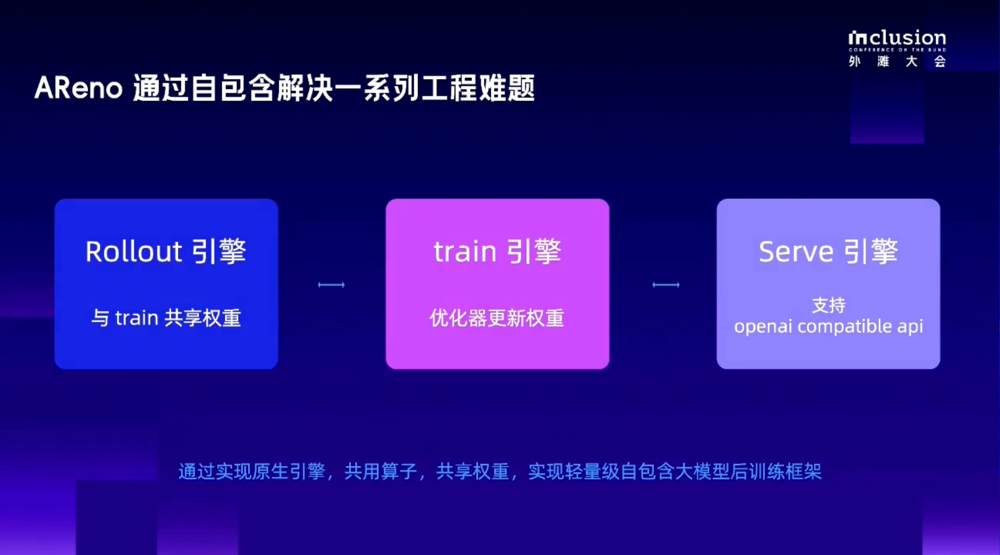
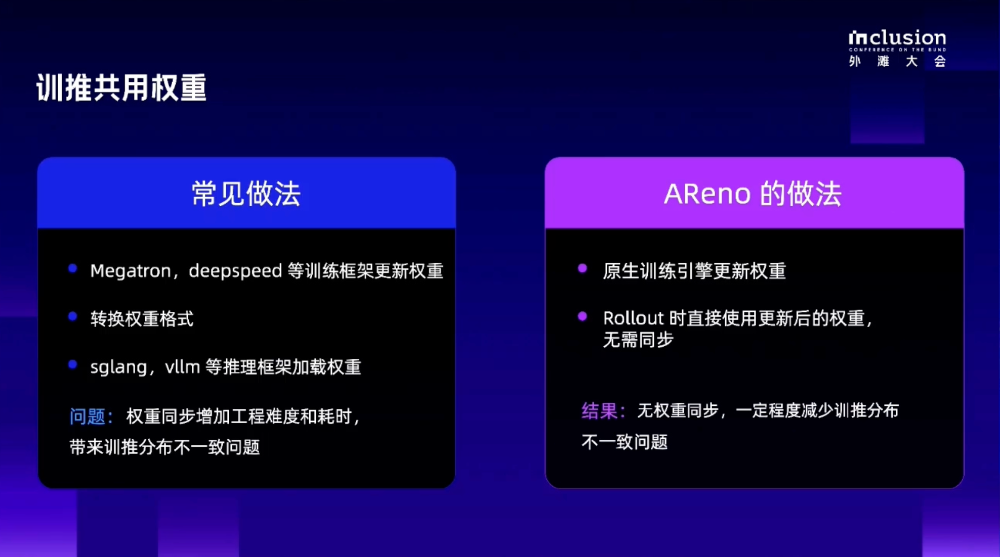
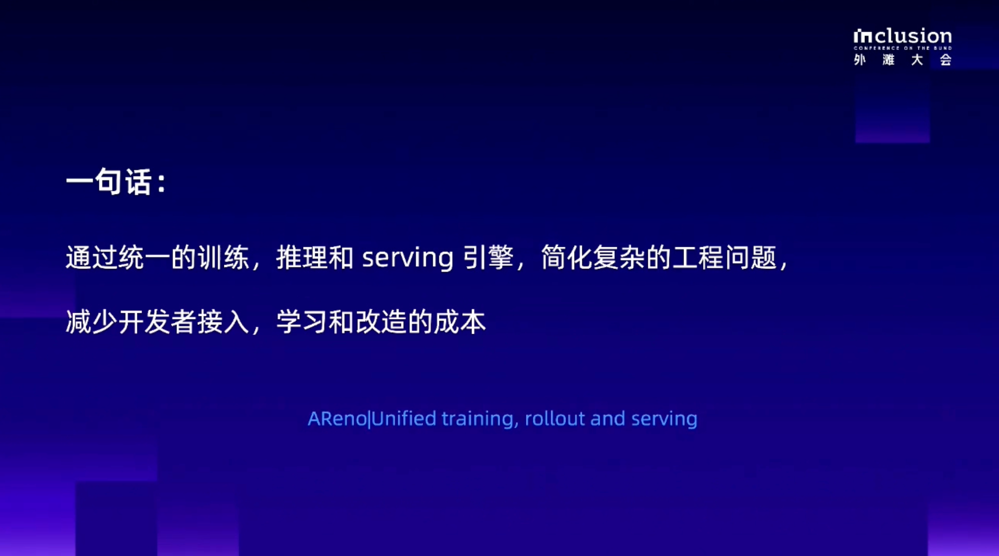

# AReno：少搭环境、少做对接，在一台机器上开始 RL 训练

[English](ASystem_AReno_Single_Node_RL_EN.md) | 简体中文

> 如果想让一个模型更擅长自己的任务，开发者往往会先调整提示词，再试着补充工具和任务信息。但有些问题，需要通过训练继续改善。比如，模型虽然知道工具的用法，执行时却经常选错参数；看起来理解了游戏规则，真正行动时又会反复犯错。
>
> 强化学习，也就是 RL，可以让模型根据任务反馈继续学习：先尝试完成任务，系统对结果打分，再根据反馈更新模型，接着进入下一轮尝试。
>
> 这个过程听起来并不复杂，实际动手时，准备工作却不少。训练框架、推理引擎、权重同步、环境依赖，每一项都可能让一个原本很具体的实验迟迟开始不了。
>
> 蚂蚁 ASystem 团队开发了 [AReno](https://github.com/inclusionAI/AReno)，将训练和推理所需的核心能力整合到同一套框架中，并针对单机环境进行优化。开发者可以少花一些时间搭建环境、对接组件，更方便地用已有模型开展面向具体任务的 RL 后训练实验。

## 一、跑一次 RL 训练，麻烦常常出在准备阶段
假设我们想训练一个会玩解谜游戏的模型。

首先，需要让模型看到游戏状态，并给出一个选择。游戏环境判断这个选择是否正确，把结果反馈回来。训练程序根据反馈更新模型，然后让它继续玩下一轮。

整个过程可以理解为：

> 尝试任务 → 获得反馈 → 更新模型 → 再次尝试。

其中，“让模型完成任务”属于推理，“根据反馈更新模型”属于训练。RL 需要反复在这两件事之间切换。

在一些方案中，训练和推理由不同引擎负责。开发者除了要分别配置它们，还要处理两者之间的衔接：训练完成一轮，如何把更新后的模型交给推理端？权重格式是否兼容？加载之后能不能正常继续生成？

如果目标只是验证一个奖励设计，或者改善模型在某个任务上的表现，这些准备工作就显得有些重。实验还没开始，时间已经花在了安装、适配和排错上。

[AReno](https://github.com/inclusionAI/AReno) 首先处理的，就是这段从“想做实验”到“开始训练”的距离。

## 二、轻依赖：把训练和推理之间的对接收进框架

在外滩大会开源嘉年华的分享中，有反复提到一个词：自包含。

可以把它理解为，AReno 把训练和推理所需的核心能力放到同一套实现中。开发者使用它时，不需要再另外拼接一套外部训练引擎和推理引擎，来承担这部分核心流程。

当然，它仍然依赖 PyTorch、CUDA 或 MLX 等基础组件。“轻依赖”指的是减少需要额外组合和维护的组件，以及这些组件之间的对接工作。

一个比较直接的变化，发生在模型更新之后。

在需要跨引擎转换的流程里，训练端更新了模型，还可能需要导出权重、转换格式，再由推理端加载。当前 [AReno](https://github.com/inclusionAI/AReno) 通过统一的训推设计，让更新后的权重直接用于后续推理，省去其中的转换环节。

对开发者来说，这意味着少处理一段中间流程，也少等待一段时间。修改奖励函数、重新训练、再看效果，可以在同一套框架里继续进行。

统一实现也方便排查训练与推理之间的差异。两个阶段对同一个模型的计算越接近，实验中的一些异常就越容易定位。不过，实际是否一致，仍然需要通过运行指标检查。

在算子层面，[AReno](https://github.com/inclusionAI/AReno) 也自行实现了部分模型计算所需的基础操作。开发者通常不需要直接修改这些算子，但安装依赖、处理兼容问题，往往会影响训练环境的搭建。尤其在网络条件受限时，光是下载依赖就可能花费不少时间。因此通过自包含的设计，减少这些准备工作，让开发者更快开始训练。

## 三、低成本：先用已有资源验证一个小任务

这里的“低成本”，需要放到具体实验里理解。

[AReno](https://github.com/inclusionAI/AReno) 面向单机优化，让开发者可以先围绕一台机器组织实验。单机也可以有多张 GPU，框架支持相应的并行方式，用于利用机器内部的资源。

对于刚开始探索 RL 的技术团队，可以先选一个较小的模型和范围明确的任务，验证训练是否有效，再决定是否扩大实验。这样更容易把资源花在有明确目标的尝试上。

[AReno](https://github.com/inclusionAI/AReno)  也在通过 LoRA 降低训练所需的资源。简单来说，LoRA 会保留基座模型的大部分参数，只训练额外加入的一小部分参数，从而减少需要更新和保存的训练状态。

它能降低部分资源开销，但模型本身仍然需要加载，生成内容和训练过程也会占用显存或内存。能跑多大的模型，还要看设备、训练方式和任务长度。

因此，[AReno](https://github.com/inclusionAI/AReno) 带来的成本变化，可以从几个实际环节来看：

| 实验中的工作 | AReno 可减轻的负担 |
| --- | --- |
| 准备运行环境 | 减少需要额外拼接的训推组件 |
| 让训练结果用于下一轮尝试 | 减少权重转换和引擎适配工作 |
| 验证训练想法 | 从单机、小模型和具体任务开始 |
| 调整训练方案 | 在同一框架内修改数据、奖励和交互逻辑 |

[AReno](https://github.com/inclusionAI/AReno) 从本质上是减少搭建和衔接工作，并为有限资源上的实验提供一种选择。

## 四、框架准备好了，开发者还需要做什么？
[AReno](https://github.com/inclusionAI/AReno) 负责组织训练流程，任务本身仍然需要开发者定义。

### 1. 先确定一个能检查结果的任务
比如，让模型按规则完成解谜，或者正确调用某个工具。任务越具体，越容易判断模型有没有进步。

开始时可以先观察基座模型的表现，找到经常发生的错误。这样，后面的训练就有一个明确的改善目标。

### 2. 告诉模型什么样的行为值得奖励
奖励函数就是任务的打分规则。模型做出一个动作之后，系统根据规则给出反馈，训练程序再利用这些反馈更新模型。

以工具调用为例，开发者需要决定怎样评价调用结果：参数是否合法，任务是否完成，是否存在需要计入评价的无效操作。这些评价方式由具体场景决定，[AReno](https://github.com/inclusionAI/AReno) 允许使用者自行定义。

### 3. 运行训练，同时检查模型的行动过程
涉及多轮交互时，模型会产生一条完整的行动记录，也就是轨迹。里面可以看到它做了什么、环境返回了什么，以及它接下来如何选择。

[AReno](https://github.com/inclusionAI/AReno) 支持工具调用和轨迹的定制、分析与调试。开发者可以结合训练面板查看奖励变化，再回到轨迹里检查原因。

这一步很有用：分数上涨之后，还需要确认模型学到的行为符合任务预期。

### 4. 用训练后的模型重新做任务
训练完成之后，回到相同测试条件下比较效果。除了看奖励，还可以检查任务成功率、工具调用错误是否减少，以及完成任务所需的尝试次数。

[AReno](https://github.com/inclusionAI/AReno) 提供了简单的模型服务能力，接口兼容 OpenAI API 格式，方便把训练后的模型接回调用流程，继续验证。

从使用者的角度看，主要工作集中在任务、数据和反馈设计上，训练与推理之间的一部分工程衔接则由框架承担。

## 五、一个解谜游戏，展示训练怎样改变模型行为
这个案例使用了一个终端风格的单词解谜游戏。

模型需要从给定单词中找到正确答案。游戏里还有一些规则：选中某些被括号包住、成对出现的词，可以获得更多尝试机会。

模型需要理解当前状态，作出选择，再根据游戏反馈继续行动。这让它成为一个可以观察多轮决策的训练任务。

使用了 Ling-tiny 模型，在 DGX Spark 上配合自定义奖励函数，训练了数百步后，tiny 模型在这个游戏中的表现比训练前更好，展示的奖励曲线也有上升。

其实我们也是利用这个“辐射”游戏案例展示了一条具体的实践路径：先选一个已有模型，给它一个规则明确的任务，再用任务反馈调整它的行为。

## 六、适合从哪里开始？
如果你已经有一个明确任务，希望通过训练改善模型行为，[AReno](https://github.com/inclusionAI/AReno)  可以作为单机实验的一个起点。尤其是在需要频繁修改奖励、观察工具调用过程，或者验证小模型能否适配任务时，减少环境和引擎对接工作，会让实验更容易推进。

目前 [AReno](https://github.com/inclusionAI/AReno)  已支持 CUDA，并加入了基于 MLX 的 Apple Silicon 支持。我们上面的“辐射游戏”的训练演示是在 DGX Spark 上完成，AReno 当前也在尝试 Mac mini 和个人 RTX 4090 上的训练。实际开始前，需要根据所用版本确认模型、硬件后端和 LoRA 等能力的支持情况。

第一次实验可以小一些：选定一个模型，准备一组任务，明确怎样打分，先跑通一次“尝试、反馈、更新、复测”的过程。等到能看清奖励设计和模型行为之间的关系，再逐步增加任务难度和训练规模。

[AReno](https://github.com/inclusionAI/AReno) 希望减少的，是这条路上反复搭环境、接引擎和转换权重的工作，让开发者更早开始验证自己的训练想法。

欢迎 Star 👉[AReno 开源仓库](https://github.com/inclusionAI/AReno)

