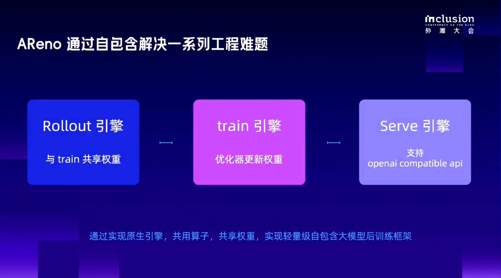
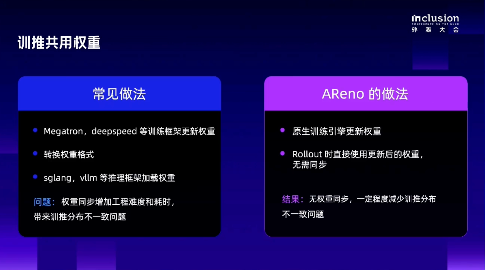
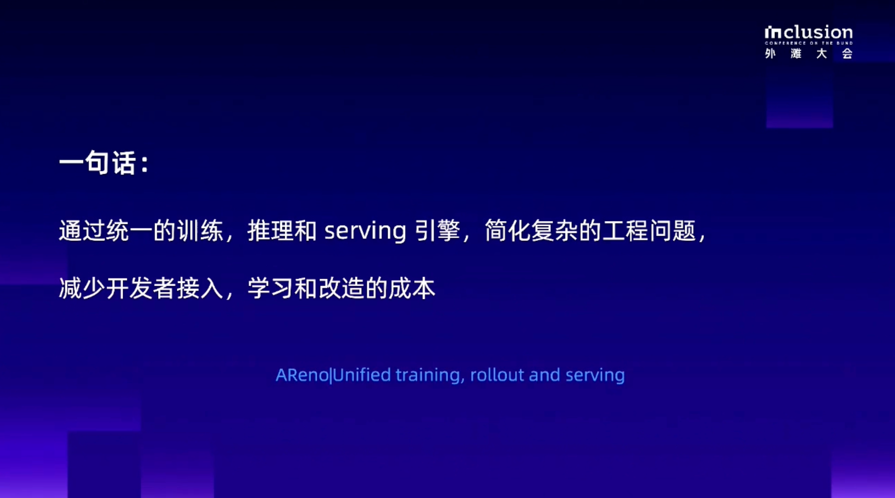

# AReno: Start RL Training on a Single Machine with Less Setup and Integration Work

English | [简体中文](ASystem_AReno_Single_Node_RL_CN.md)

> When developers want a model to perform better on their tasks, they often start by adjusting prompts, adding tools, and providing more task context. Some problems, however, call for further training. A model may know how a tool works yet repeatedly choose the wrong arguments. It may appear to understand a game's rules yet keep making mistakes when it actually plays.
>
> Reinforcement learning, or RL, lets a model continue learning from task feedback. The model first attempts a task, the system scores the result, and the training program updates the model using that feedback before the next round of attempts.
>
> The process sounds straightforward, but getting started can take considerable preparation. Training frameworks, inference engines, weight synchronization, and environment dependencies can each delay an otherwise focused experiment.
>
> Ant Group's ASystem team developed [AReno](https://github.com/inclusionAI/AReno) to bring the core capabilities required for training and inference into one framework, optimized for a single machine. Developers can spend less time setting up environments and connecting components, making it easier to run task-specific RL post-training experiments with existing models.

## 1. The Trouble with Running an RL Experiment Often Starts Before Training

Suppose we want to train a model to play a puzzle game.

First, the model needs to see the game state and make a choice. The game environment evaluates that choice and returns feedback. The training program then updates the model using the feedback and lets it play another round.

The process can be understood as:

> Attempt a task → Receive feedback → Update the model → Try again.

Having the model perform the task is inference. Updating the model from feedback is training. RL repeatedly switches between these two activities.

In some systems, separate engines handle training and inference. Besides configuring both engines, developers must connect them. After a round of training, how do the updated weights reach the inference engine? Are the weight formats compatible? Can generation continue correctly after loading them?

If the goal is simply to validate a reward design or improve performance on a particular task, this preparation can feel disproportionate. Before the experiment even begins, time has already gone into installation, adaptation, and troubleshooting.

The first problem [AReno](https://github.com/inclusionAI/AReno) addresses is the distance between wanting to run an experiment and actually starting training.

## 2. Fewer Dependencies: Bringing Training–Inference Integration into the Framework

One word came up repeatedly in the presentation at the INCLUSION Conference's open-source carnival: self-contained.

For AReno, this means putting the core capabilities required for training and inference into the same implementation. Developers do not need to assemble a separate external training engine and inference engine to run this core workflow.

AReno still depends on foundational components such as PyTorch, CUDA, or MLX. Having fewer dependencies means reducing the number of additional components that need to be assembled and maintained, together with the integration work between them.

One direct difference appears after a model update.

In a workflow that crosses engine boundaries, the training engine may need to export the updated weights and convert their format before the inference engine can load them. With AReno's unified training and inference design, the updated weights can be used directly for subsequent inference, removing that conversion step.

For developers, this means one fewer intermediate workflow to manage and one fewer wait. They can modify the reward function, train again, and inspect the results within the same framework.

A unified implementation also makes it easier to investigate differences between training and inference. The closer the computations in both stages are for the same model, the easier it can be to locate certain experimental anomalies. Actual consistency still needs to be checked through runtime metrics.

At the operator level, AReno also implements some of the basic operations needed for model computation. Developers usually do not need to modify these operators directly, but installing dependencies and resolving compatibility issues can affect environment setup. Under constrained network conditions, downloading dependencies alone can take substantial time. The self-contained design reduces this preparation so developers can start training sooner.

## 3. Lower Cost: Validate a Small Task with the Resources You Already Have

Lower cost needs to be understood in the context of a specific experiment.

[AReno](https://github.com/inclusionAI/AReno) is optimized for a single machine, allowing developers to organize an experiment around one host. A single machine can also contain multiple GPUs, and the framework supports parallelism to use those resources.

Technical teams beginning to explore RL can start with a smaller model and a clearly scoped task, verify whether training helps, and then decide whether to scale the experiment. This makes it easier to direct resources toward attempts with a clear objective.

AReno also uses LoRA to reduce the resources required for training. In simple terms, LoRA keeps most base-model parameters frozen and trains a small set of additional parameters, reducing the training state that must be updated and saved.

This can reduce some resource requirements, but the model itself still needs to be loaded. Generation and training also consume GPU or system memory. The model size an experiment can accommodate depends on the device, training method, and task length.

The cost changes AReno offers can therefore be considered at several practical stages:

| Work involved in an experiment | Work AReno can reduce |
| --- | --- |
| Preparing the runtime environment | Fewer separate training and inference components to assemble |
| Using training results in the next round of attempts | Less weight conversion and engine adaptation |
| Testing a training idea | Start with a single machine, a small model, and a concrete task |
| Adjusting the training approach | Modify data, rewards, and interaction logic within the same framework |

AReno reduces setup and integration work and offers an option for experiments with limited resources.

## 4. Once the Framework Is Ready, What Does the Developer Still Need to Do?

AReno organizes the training workflow. Developers still need to define the task itself.

### 1. Choose a task with a checkable outcome

For example, a model might solve a puzzle according to specific rules or call a tool correctly. The more concrete the task, the easier it is to determine whether the model has improved.

Start by observing the base model and identifying recurring mistakes. This gives the subsequent training a clear improvement target.

### 2. Define which behavior deserves a reward

The reward function is the task's scoring rule. After the model takes an action, the system provides feedback according to that rule. The training program then uses the feedback to update the model.

For tool calling, developers need to decide how to evaluate the result: whether the arguments are valid, whether the task was completed, and whether ineffective operations should count against the score. These choices depend on the specific scenario, and AReno allows users to define them.

### 3. Run training and inspect the model's actions

In a multi-turn interaction, the model produces a complete sequence of actions, or trajectory. It records what the model did, what the environment returned, and what the model chose next.

AReno supports customization, analysis, and debugging of tool calls and trajectories. Developers can inspect reward changes in the training dashboard, then return to the trajectories to investigate the causes.

This matters because an increasing score still needs to be checked against the behavior the task actually requires.

### 4. Run the task again with the trained model

After training, compare the results under the same test conditions. Besides rewards, inspect task success rates, whether tool-calling errors decreased, and how many attempts it takes to complete the task.

AReno provides a simple model-serving capability with an OpenAI-compatible API format. This makes it easier to reconnect the trained model to the calling workflow and continue evaluation.

For users, the main work centers on tasks, data, and feedback design, while the framework handles part of the engineering integration between training and inference.

## 5. A Puzzle Game Shows How Training Can Change Model Behavior

This case uses a terminal-style word puzzle.

The model must find the correct answer among a set of candidate words. The game also has special rules: selecting certain paired words enclosed in brackets can provide more attempts.

The model needs to understand the current state, make a choice, and continue acting based on the game's feedback. This makes the game a useful task for observing multi-turn decisions during training.

Using the Ling-tiny model on DGX Spark with a custom reward function, the demonstration trained for several hundred steps. After training, the tiny model performed better in this game, and the reward curve shown in the demonstration also increased.

The Fallout-style word puzzle illustrates a concrete path: choose an existing model, give it a task with clear rules, and use task feedback to adjust its behavior.

## 6. Where Should You Start?

If you already have a clear task and want to improve model behavior through training, AReno can serve as a starting point for a single-machine experiment. Reducing environment setup and engine integration is particularly helpful when you need to change rewards frequently, inspect tool calls, or test whether a small model can adapt to a task.

AReno currently supports CUDA and has added Apple Silicon support through MLX. The word-puzzle demonstration described above ran on DGX Spark. AReno is also being tried for training on Mac mini and a personal RTX 4090. Before starting, check the version you plan to use for supported models, hardware backends, and capabilities such as LoRA.

Keep the first experiment small. Choose a model, prepare a set of tasks, define the scoring rule, and complete one cycle of attempting the task, receiving feedback, updating the model, and evaluating it again. Once you can see the relationship between reward design and model behavior, gradually increase task difficulty and training scale.

AReno aims to reduce the recurring work of environment setup, engine integration, and weight conversion so developers can begin testing their training ideas sooner.

Star the [AReno open-source repository](https://github.com/inclusionAI/AReno).

