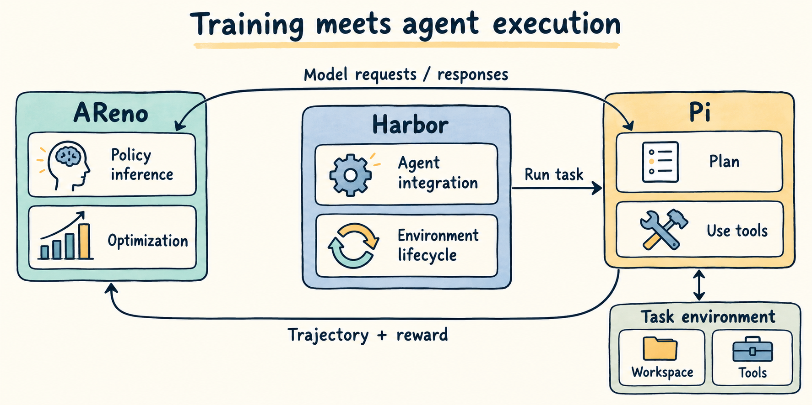
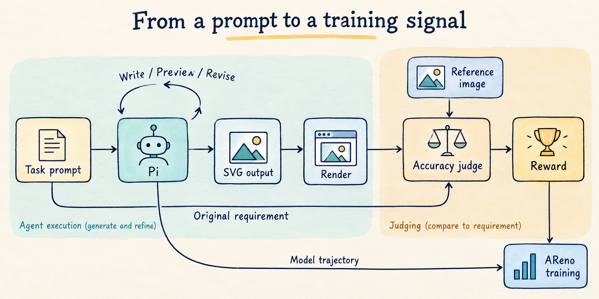
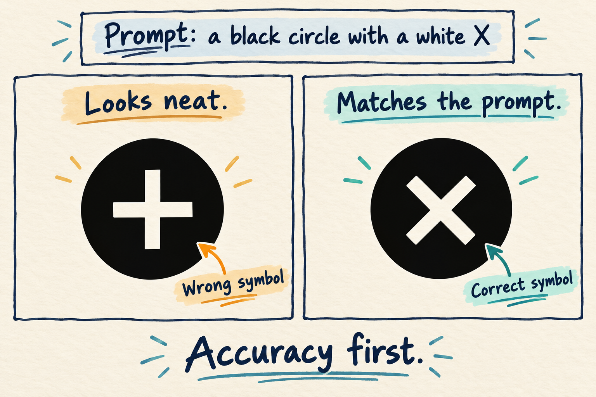
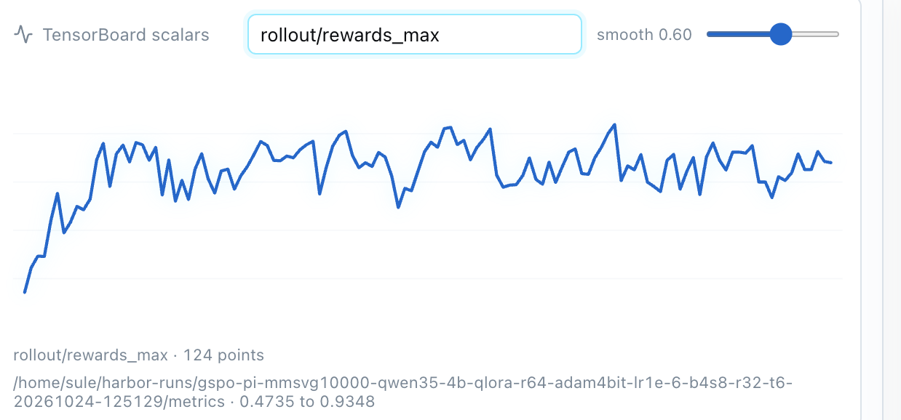
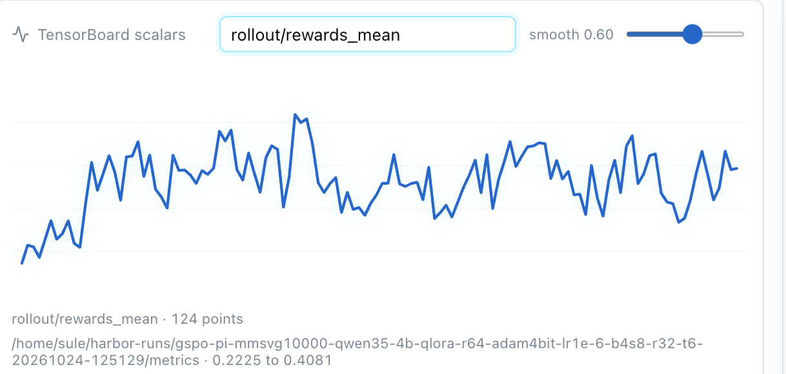
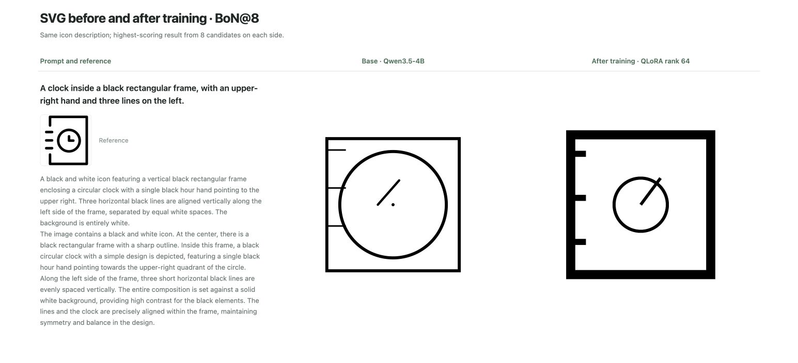
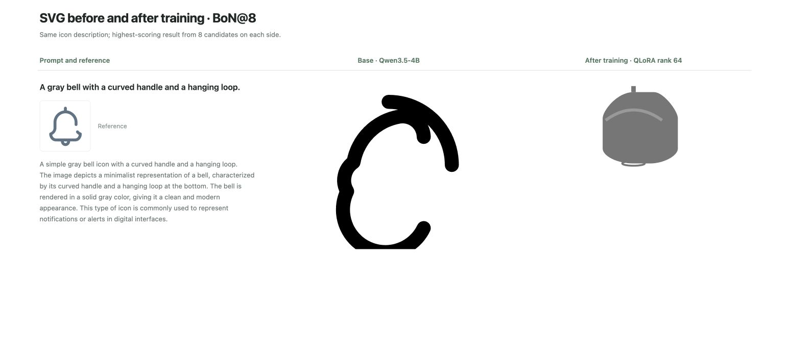
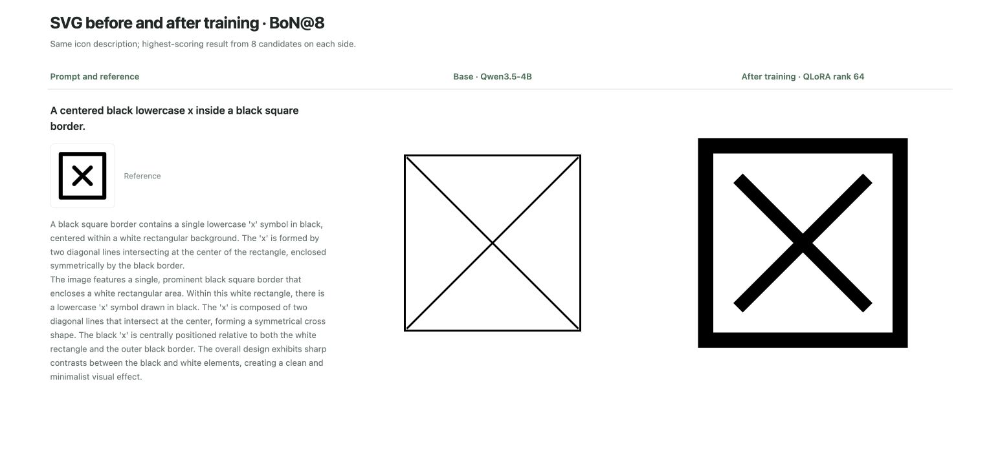
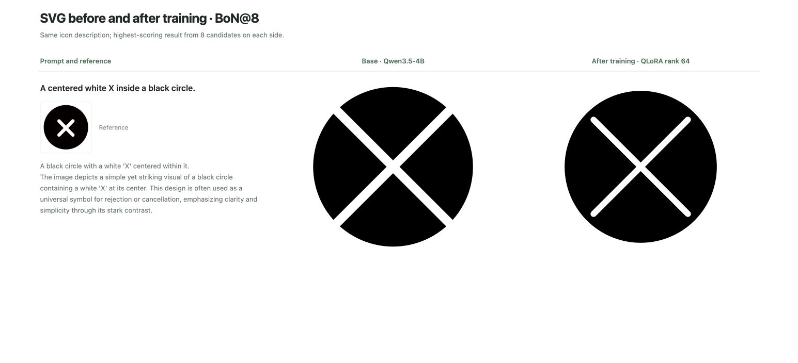

# 在 NVIDIA DGX Spark 上使用 AReno 训练 Pi 智能体

*以 SVG 生成为例，介绍如何在 NVIDIA DGX Spark 上，使用 AReno 对驱动 Pi 智能体的 Qwen3.5 模型进行强化学习训练。*

借助 [AReno](https://github.com/inclusionAI/AReno)，开发者可以直接在 NVIDIA DGX Spark 上进行本地大模型训练。[DGX Spark](https://www.nvidia.com/en-us/products/workstations/dgx-spark/) 是一款紧凑型桌面系统，搭载 GB10 超级芯片，集成 Grace CPU 和 Blackwell GPU，并提供最高 **128 GB 的 CPU/GPU 统一内存**。AReno 采用轻量、自包含的设计，适合在这类桌面设备上开展本地训练。

本文将以 SVG 生成为任务，在 DGX Spark 上使用 **GSPO 和 QLoRA** 训练 **Qwen3.5-4B**，并通过 [Harbor](https://github.com/harbor-framework/harbor) 接入 [Pi](https://github.com/earendil-works/pi) 智能体执行框架（harness）。开发者可以沿用 Pi 的编码与工具调用流程，用强化学习优化驱动智能体的模型。

## 训练流程

一个典型的智能体强化学习（Agentic RL）训练循环如下图所示。AReno 负责提供模型推理服务并更新模型权重；Harbor 负责管理任务环境和智能体生命周期；Pi 则执行实际的编码流程。



在本文的 SVG 生成任务中，每个任务都包含一段来自 [OmniSVG/MMSVG-Icon](https://huggingface.co/datasets/OmniSVG/MMSVG-Icon) 数据集的图标描述，以及工作空间、预览工具和 SVG 评分方式。Pi 只能收到文字描述；参考图像仅供评分器使用，与 Pi 的工作空间隔离。因此，智能体需要根据文本要求生成 SVG。

一次训练循环包含以下步骤：

1. **采集执行轨迹。** AReno 针对每个任务运行多次 rollout，即让智能体分别完成多次任务尝试。每次尝试都有独立的工作空间和执行记录。Harbor 在任务环境中启动 Pi，并将其模型调用转发给 AReno 当前的策略模型。
2. **生成并迭代 SVG。** Pi 编写、预览并修改 SVG，根据命令执行和文件操作的反馈决定下一步行动。AReno 在此过程中记录模型生成的 token，以及训练所需的采样信息。
3. **评估结果并更新模型。** Pi 完成任务后，系统渲染提交的 SVG 并评分。AReno 将评分与对应的执行轨迹用于 GSPO 训练，更新模型权重。
4. **保存结果，进入下一轮。** 清理环境前保存产物和日志，下一轮任务使用更新后的模型执行。



## 奖励规则：优先判断是否满足任务要求

奖励决定了模型会朝哪个方向优化，因此评分规则必须与任务目标一致。对于 SVG 生成任务，提交的文件首先必须能够被解析和渲染，且渲染结果不能为空白图像。未提交文件、文件无效或渲染结果为空白时，奖励均为零。通过这些检查后，由 Qwen3.8-Flash-Next 对照原始任务描述评估渲染图像，并借助参考图像理解任务要求。

评分关注主体、组成部分、数量、方向和空间关系是否正确。只有当任务描述明确要求颜色或风格时，这些因素才纳入评分；画面精致程度本身不单独加分。



例如，任务要求在黑色圆形中绘制一个白色 X，即使生成的白色加号十分工整，也没有满足要求，奖励应当反映这一偏差。评分器会读取完整的原始描述，确保将描述转换成智能体任务时，不会遗漏评分所依据的要求。最终，准确度评分经归一化后，作为训练奖励。

## 训练实操

开始训练前，请先按照 [Pi SVG 环境配置指南](https://asystem-ai.io/docs/areno/integrations/harbor/pi.html) 安装所需工具，并配置视觉语言模型（VLM）评分器。准备完成后，在 DGX Spark 上执行以下命令：

```bash
git clone https://github.com/inclusionAI/AReno

cd AReno

# 从源码安装 AReno
pip install -e . --no-build-isolation

areno train --ckpt Qwen/Qwen3.5-4B --algo gspo \
  --dataset-path OmniSVG/MMSVG-Icon \
  --dataset-loader-fn examples/agentic/pi/svg_dataset_loader.py \
  --agent-fn examples/agentic/pi/run_svg_agent.py \
  --reward-fn-path examples/agentic/pi/reward.py \
  --batch-size 4 --n-samples 8 --max-running-prompts 32 \
  --qlora --lora-rank 64 --adam-4bit
```

训练过程中，可以通过 AReno 内置的监控面板查看 `rewards_mean`、`rewards_max` 等指标，观察平均奖励和最大奖励的变化。





## 训练前后的效果对比

我们使用 **BoN@8（Best-of-8）** 比较训练前后的结果：对于同一条任务描述，训练前和训练后各采样 8 个完整候选结果，再由评分器分别选出每组中得分最高的结果。Pi 生成一个候选结果时，可能会经历多轮工具调用。因此，这里的“8”指完整候选结果的数量，并非模型调用次数。

以下四组示例来自本地 SVG 报告。每张图的左列是任务描述与参考图像，中列是原始 Qwen3.5-4B 的结果，右列是经过 QLoRA 训练后的策略模型通过 Pi 生成的结果。在这些展示的案例中，可以直观看到训练后生成效果的改善。









这个示例展示了使用 AReno 在本地训练智能体模型的一种方式。结合 Harbor 和 Pi，开发者可以在已有的智能体工作流中训练自己的模型，并将同样的方法扩展到更多编码任务。欢迎试用、参与 [AReno](https://github.com/inclusionAI/AReno)，也欢迎在 GitHub 上为项目点亮 Star。
