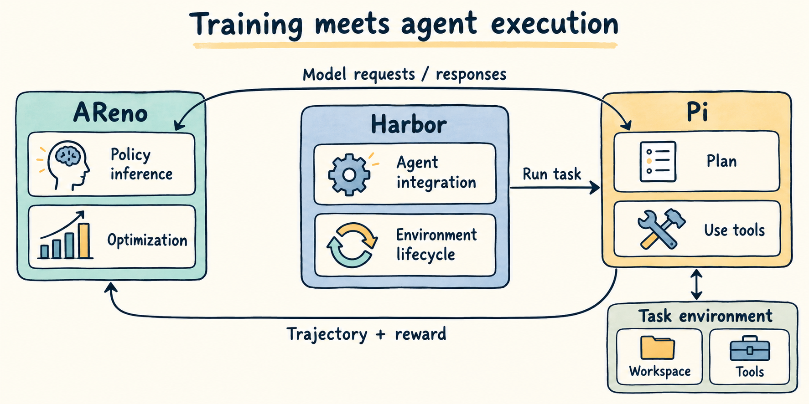
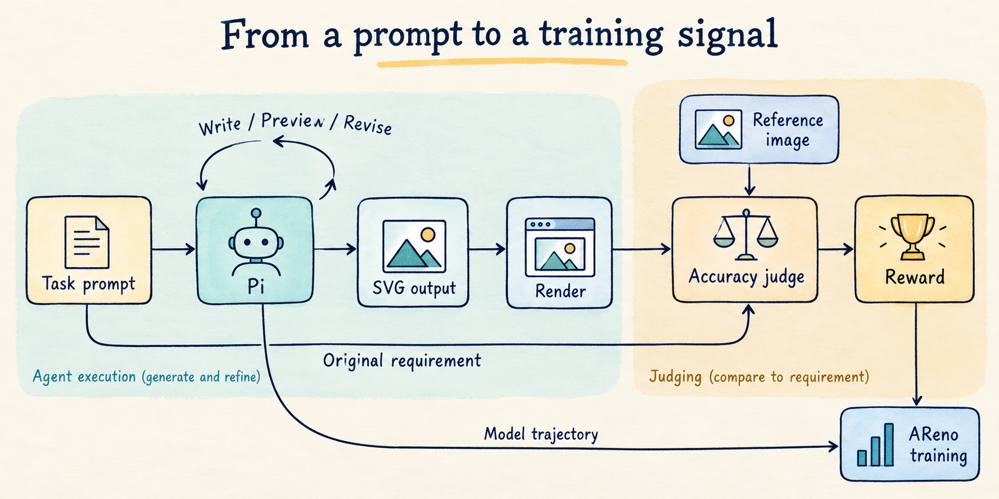
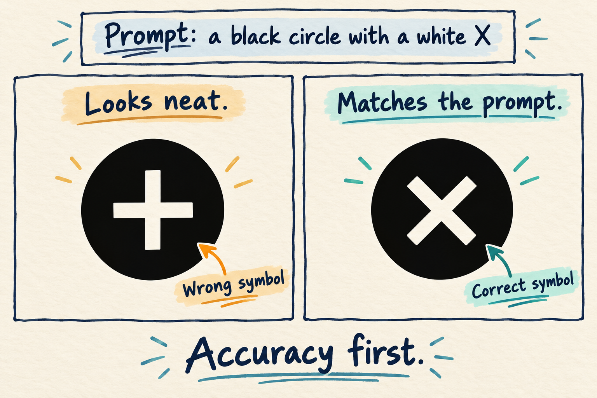
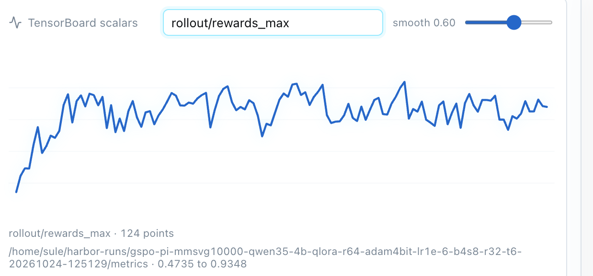
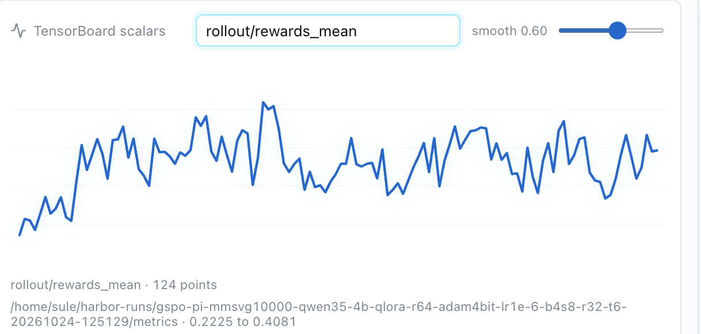
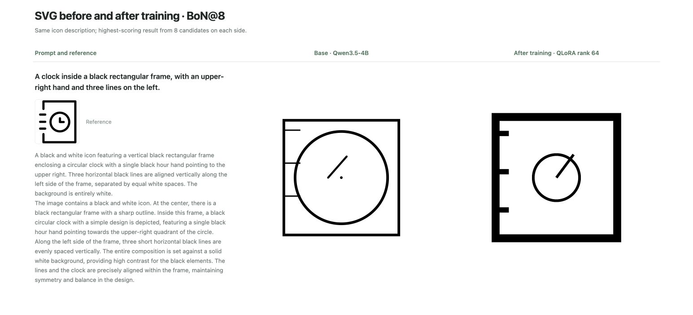
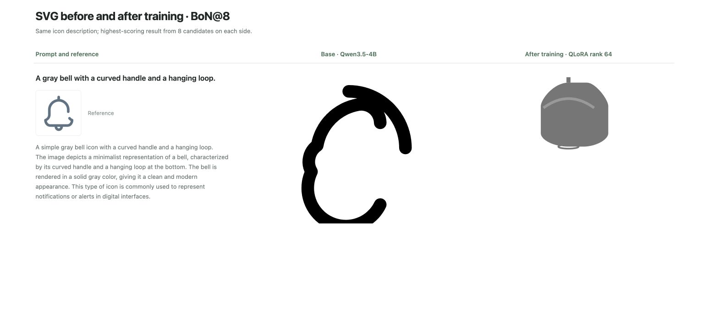
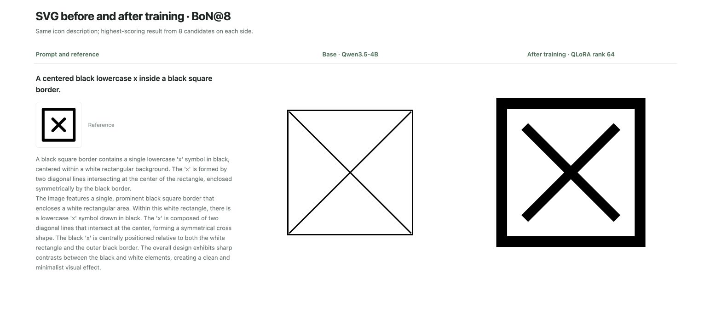
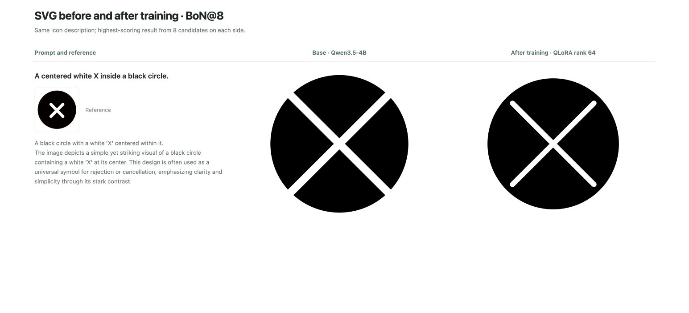

# Training Pi Agent with NVIDIA DGX Spark and AReno

*Tutorial on how to do Pi Agent RL training with Qwen3.5 on NVIDIA DGX Spark.*

You can now train LLMs locally on your NVIDIA DGX Spark with [AReno](https://github.com/inclusionAI/AReno). [DGX Spark](https://www.nvidia.com/en-us/products/workstations/dgx-spark/) has up to **128 GB of unified CPU/GPU memory** and combines a Grace CPU with a Blackwell GPU through its GB10 Superchip in a compact desktop system. AReno's lightweight, self-contained design makes it an ideal choice for local training on DGX Spark.

In this guide, we'll use AReno to train **Qwen3.5-4B** with **GSPO and QLoRA** on DGX Spark for SVG generation using [Pi](https://github.com/earendil-works/pi) harness and [Harbor](https://github.com/harbor-framework/harbor).

## Training Loop

A typical Agentic RL training loop works as below diagraom: AReno serves the model and updates its weights, while Harbor manages the task environment and agent lifecycle, Pi runs the real coding loop.



For this specific SVG generation coding task, each task contains an icon description from [OmniSVG/MMSVG-Icon](https://huggingface.co/datasets/OmniSVG/MMSVG-Icon) dataset, a workspace, preview tools, and method to score the submitted SVG. Pi only receives the description, the reference image stays with the judge and is isolated from the workspace, which makes the agent work from the text requirement rather than copy the reference.

AReno runs multiple rollouts per task, each with its own workspace and execution record. Harbor launches Pi in the task environment and routes its model calls to AReno's current policy. Pi agent writes, previews, and revises the SVG, using feedback from commands and file operations to decide what to do next. Throughout the rollout, AReno records the generated tokens and sampling information needed for training. Once Pi finishes, the SVG is rendered and scored. AReno uses this score and the recorded trajectory to train the model with GSPO. Results and logs are saved before cleanup. The next round uses the updated model.



## Reward Rubric

The reward defines what the model learns to improve, it's so important to design reasonable reward rubric. In this task, the submitted SVG must parse, render, and produce a nonblank image. Missing, invalid, or blank submissions receive zero reward. Otherwise, Qwen3.8-Flash-Next grades the rendered image against the original prompt, using the reference image to clarify the requested content.

The rubric checks the subject, parts, counts, directions, and spatial relationships. Color and style count when the prompt asks for them. Visual polish earns no separate credit.



A white plus sign inside a black circle can look perfectly tidy and still fail a request for a white X. The reward should reflect that mismatch. The judge sees the full source prompt, so requirements do not disappear when the description is turned into an agent task. Its accuracy score is normalized into the training reward.

## Training Tutorial

Before training, follow the [Pi SVG setup guide](https://asystem-ai.io/docs/areno/integrations/harbor/pi.html) to install the required tools and configure VLM judge, then run the following command on your DGX Spark to start training.

```bash
git clone https://github.com/inclusionAI/AReno

cd areno

# install AReno from source
pip install -e . --no-build-isolation

areno train --ckpt Qwen/Qwen3.5-4B --algo gspo \
  --dataset-path OmniSVG/MMSVG-Icon \
  --dataset-loader-fn examples/agentic/pi/svg_dataset_loader.py \
  --agent-fn examples/agentic/pi/run_svg_agent.py \
  --reward-fn-path examples/agentic/pi/reward.py \
  --batch-size 4 --n-samples 8 --max-running-prompts 32 \
  --qlora --lora-rank 64 --adam-4bit
```

With AReno built in dashboard, you can see various metrics during the training process, e.g. `rewards_mean`, `rewards_max`.





For results comparision, we use BoN@8, or Best-of-8: sample eight complete candidates for the same prompt on each side, then use the judge to select the highest-scoring candidate from each group. A Pi candidate can include multiple rounds of tool use, so eight counts candidates rather than model calls.

The following four examples come from the local SVG report. The left column contains the prompt and reference image, the middle shows the original Qwen3.5-4B, and the right shows the trained QLoRA policy running through Pi. Obviously You can see a clear, visible improvement after training.









The above training tutorial shows what you can build locally with AReno. Together with Harbor, and Pi, we aim to make it easier for developers to train their own models within existing agent workflows and apply the same approach to more coding tasks. Come on join us if you want to play something and ⭐ Star us on [Github](https://github.com/inclusionAI/AReno) ⭐
