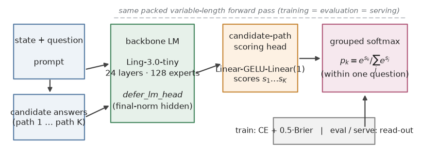
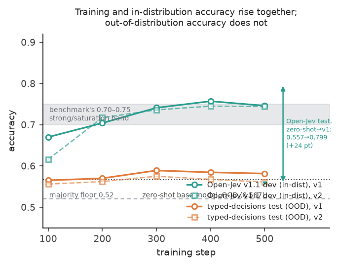
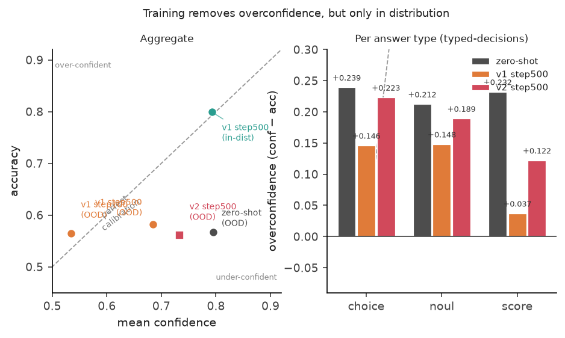
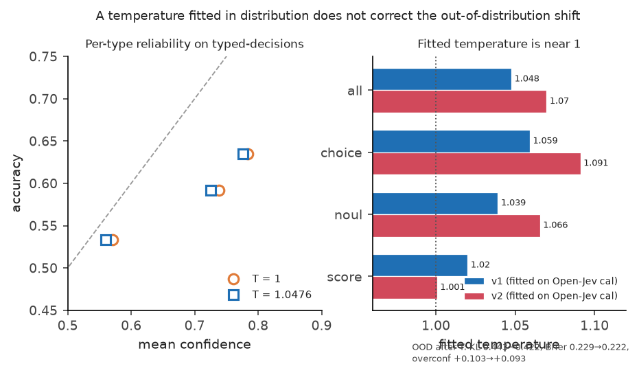
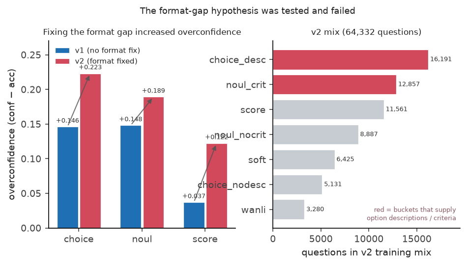
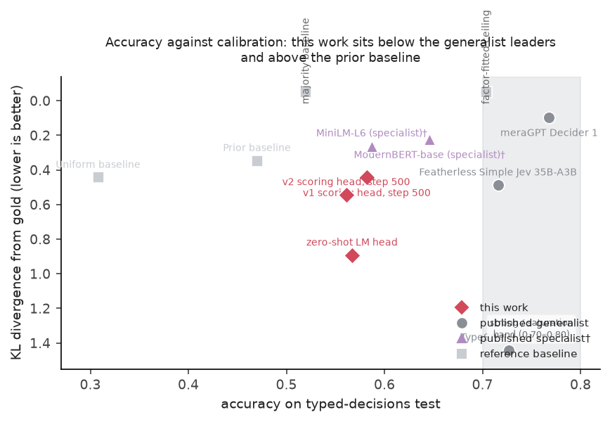

# 面向通用业务决策的单卡语言模型可训练打分头

**作者：** [待补充]

**单位：** [待补充]

**通讯作者：** [待补充]

---

## 摘要

`typed-decisions` 等通用决策基准要求模型在统一的对外服务契约下回答异构业务问题，涵盖强制选择、布尔判断和有序打分三类。紧凑指令模型能否通过任务特定训练（而非靠规模）在该基准上取得提升，目前尚不清楚。本文在 AReno 中为 `Ling-3.0-tiny`（24 层、128 专家、1536 隐层维度）训练了一个 JevForge 风格的可训练逐序列打分头，采用分组 softmax 让同一问题的所有候选答案共享一次归一化，并使用交叉熵与 Brier 项组合的损失。训练与推理都走同一段打包变长前向，因此不引入训练-推理差异。我们在单台 NVIDIA DGX Spark（GB10，128 GB 统一内存）上完成了三组受控训练和一条零样本基线。打分头在 `typed-decisions` test 上取得 0.582 准确率，与未训练基座语言模型头的 0.567 在统计上无法区分。训练没有提升准确率，但确实改善了校准：KL 散度从 0.893 降至 0.316–0.443，Brier 分数从 0.326 降至 0.178–0.229，过自信从 +0.228 变为 −0.030 至 +0.103 之间。训练最明确的收益出现在同分布上，Open-Jev v1.1 准确率提升了 24 个点。补齐缺失的答案格式结构无助于改善，而不对口的打分数据源反而降低了 score 准确率。这些结果表明，在该基准上这条微调路线的上限由基座模型自身的零样本决策能力，或由其与基准教师的标注一致性所决定；其可靠价值在于校准而非能力。

**关键词：** 决策打分、校准、参数高效微调、混合专家、大模型评测、分组 softmax

---

## 1. 引言

语言模型正越来越多地被要求做出业务决策，而不是生成自由文本。在发票处理、安全事件研判、客服路由和 agent 轨迹审查等应用中，模型接收一个结构化状态，并须给出三类答案之一：在带描述的选项中做出选择、给出布尔判断，或给出有序等级上的取值。`typed-decisions` 基准在 Jev 决策评测家族中形式化了这一设定。它包含 400 个 case 和 2000 个决策，当前榜单同时包含专用系统和通用模型，从准确率 0.727 的 Jev 1.13 到接近 0.716 的通用条目。

本研究由两个问题驱动。第一，紧凑模型能否通过任务特定训练而非规模，逼近该水平。第二，这种训练究竟改变了什么。一个决策模型至少可以沿两条不同路径改善：它可以变得更准确，也可以对自己该有多自信变得更校准。这两种结果具有不同的实用价值，且不可相互替代。

我们检验的路线与 JevForge 架构同构：一个骨干语言模型，配一个独立可训练的、对每条候选答案路径打分的打分头。我们在 AReno 中以实验性分类算法实现该路线，并将其应用于混合专家模型 `Ling-3.0-tiny`。随后我们在 `typed-decisions` 上评测，该基准完全留出，相对于我们的训练数据以严格零样本方式使用。本研究的核心问题只有一个：在 `typed-decisions` 上，训练候选路径打分头能否超过基座模型自身的零样本能力？

为回答该问题，我们在完全相同的超参下比较三组训练：第一组数据混合由 Open-Jev v1.1 构建，第二组补齐了第一组缺失的答案格式结构，第三条为零样本基线，直接使用基座模型的语言模型头。我们分离各因素的影响，并报告每个存档点的校准行为。我们还验证了本地评测能精确复现公开基准的 uniform 基线，并对训练数据与测试集的潜在重叠做了筛查。

---

## 2. 相关工作

本文研究的基准属于近期一条把语言模型评测从标签预测重新定义为带类型概率决策的研究脉络。`typed-decisions` 是一个独立基准，建立在 TypeSafe AI 所用的 System One 原语之上 [1]，并围绕 `noul`、`choice` 和 `score` 三种答案类型构建 [2]。它的构造方式有两点不寻常之处，直接影响对本文结果的解读。第一，gold 标签由一个约 4B 量级的教师端点以温度 0.7 采样三次后取均值，因此得分衡量的是与教师的标注一致性而非正确性；数据集卡片给出的参照点为：多数类基线 0.520、拟合潜在生成因子的模型 0.704、教师自一致 0.735，饱和点约在 0.75 [2]。第二，卡片明确指出，在教师答错处答对的模型会被扣分，且各问题的上限差异很大，从 `agent_trace/urgency` 的 0.560 到 `customer_service/category` 的 0.937 [2]。我们的评测继承了这些性质，并在第 5 节讨论其后果。

该基准区分通用模型（generalist，零样本回答任意问题模式）与按工作流拟合、标签空间固定的专用模型（specialist），并说明二者不可直接比较 [2]。已公开的通用条目包括准确率 0.727 的 TypeSafe Jev 1.13.0、0.716 的 Featherless Simple Jev，以及专有的 meraGPT Decider 1（0.768）[2,3,4]。已公开的专用条目包括按工作流分别拟合的 ModernBERT-base（0.646）和 MiniLM-L6（0.587）[2,5,6]。本文属于前一种意义上的通用评测：模型在其他工作流上训练，随后零样本应用，因此我们只与通用条目比较。

共享归一化的候选路径打分与分类和语言建模中的分组 softmax 目标相关 [7]，也与信息检索与推荐中的 listwise 排序目标相关，后者对同一查询下的候选进行联合打分。我们显式采用分组：同一问题的候选答案共享一个 softmax。正是这一性质使打分头成为决策模型，而非彼此独立的 token 分类器；也正是这一性质使交叉熵与 Brier 损失能够在同一个候选单纯形上同时良定义。

Brier 分数源自概率预测领域 [8]，将其与交叉熵这类严格恰当评分规则组合使用，是评测概率预测的标准做法 [9]。神经网络置信度校准是一个长期研究的问题 [10]，事后温度缩放是广泛使用且有效的补救手段 [11]。本文与单纯的校准文献有两点不同：我们研究可训练打分头在训练过程中如何改变校准，而不只是应用一次事后修正；并且我们检验同分布拟合的温度能否迁移到分布外的决策基准。

对指令微调语言模型做监督微调是任务适配的标准路线 [12]，LoRA 等参数高效变体降低了其成本 [13]。其收益取决于目标任务与预训练分布之间的距离，同分布集合上的增益未必能迁移到分布不同的留出集合 [14]。我们的设计正是针对这一顾虑：把同分布指标（Open-Jev）与分布外指标（`typed-decisions`）分开并同时报告。

从更强教师蒸馏软标签，是把学生单靠硬标签无法获得的知识迁移过来的成熟做法 [15]，也是为紧凑基座模型注入其本身不编码的决策知识的最自然候选。本文未测试蒸馏，但在第 5 节将其列为在我们看来唯一可能改变所观测上限的路线。

如 `Ling-3.0-tiny` 这类混合专家模型还带来一层额外考量。稀疏路由对输入分布敏感，改变输入分布的适配过程可能以稠密模型不会出现的方式改变该模型 [16]。我们只报告本路线在该模型族上观测到的局限，不跨架构推广。

---

## 3. 方法

### 3.1 任务形式化

一个任务实例把一个业务 `state` 与一个问题配对，问题类型为以下三者之一：`choice`，答案是在若干带描述选项上的软分布，不要求 one-hot；`noul`（no-utility-label），答案是 true 或 false；`score`，答案是在有序等级上的分布，以期望等级评测。问题可携带 `criteria`，描述答案应如何评判。

对每个问题，我们由 state 与问题渲染出 prompt，再把每个候选答案渲染为 prompt 后接答案标记与候选文本。模型对每条候选路径打分，同一问题的所有候选分数一起归一化。该形式化同时提供了监督信号与评测流程。

### 3.2 总体设计

系统由四部分组成，共享同一段前向：骨干语言模型、替代语言模型头的可训练打分头、分组 softmax 损失，以及复用同一份代码的评测与服务路径。图 1 展示了整体流程。设计目标是消除训练、评测与服务之间的一切差异，使训练-推理差异不可能混淆比较结果。

**图 1 | 打分头流程。** 业务 state 与问题被渲染为 prompt。每条候选答案路径追加答案标记并分词。骨干在推迟语言模型头的情况下输出 final-norm 隐状态，候选路径打分头读取每条路径的末 token。同一问题的候选分数共享一个 softmax，产生一个分布：训练时与目标分布比较，评测与服务时读取出 choice、布尔或 score 答案。三个阶段使用同一段打包变长前向。



### 3.3 候选路径打分头

打分头是一个小型多层感知机，`Linear(1536,1536) - GELU - Linear(1)`，读取每条候选路径末 token 的 final-norm 隐状态，为每条路径返回一个标量分数。其架构遵循 JevForge 参考实现 [28]。该模块之所以存在，是因为语言模型头在整个词表上预测下一 token，这对比较完整候选路径而言是错误归纳偏置。只读取路径末 token 并投影为标量，得到可与其兄弟候选比较的逐候选分数。

骨干以 `defer_lm_head=True` 调用，完全跳过语言模型头。打分头以固定随机种子初始化，以保证多数据并行 rank 一致，并以 `score_head.safetensors` 保存，键为 `0.weight`、`0.bias`、`2.weight`、`2.bias`。语言模型头的推迟在我们的引擎中已为四个模型族实现，这一实现边界界定了打分头可挂载与不可挂载的骨干。

### 3.4 分组 softmax 目标

对一个含若干候选分数的问题，我们在问题内部而非整个 batch 上计算 softmax。实现使用 `scatter_reduce` 求最大值，随后以 `index_add` 归一化，从而保证分段精确且不依赖候选顺序。逐问题损失把对目标分布的交叉熵与 Brier 项组合：

`L = CE + brier_weight * Brier`，

其中 `brier_weight` 取 0.5。Brier 项惩罚交叉熵单独可以容忍的校准偏差概率质量。因打包而产生的、不属于任何问题的行被赋组索引 −1，排除在损失之外，同时保留计算图锚点。

选择分组 softmax 是刻意的。若对候选独立打分，模型表达的置信度就可能与它实际面对的备选项无关，这与决策任务不符。让同一问题的候选共享一次归一化，使输出成为真实备选项上的恰当分布，也使交叉熵与 Brier 在同一单纯形上都有良好定义。

### 3.5 步组织与打包

一个问题绝不跨 microbatch 或数据并行 rank 切分，否则会破坏分组归一化。训练器按 token 数一阶递减排序把问题装箱为一步，使 microbatch token 数接近目标且无需 padding。训练与推理都使用打包变长序列，因此两种模式的前向完全相同。

梯度在数据并行与 microbatch 平均之前按问题权重归一化，使最终更新等于对所有问题取均值，而非对 microbatch 取均值。这一细节重要，因为各问题的 token 数差异很大。

### 3.6 优化设置

我们对学习率分组。骨干用 2e-5 并余弦衰减至零，打分头用 2e-4，配 12 步的仅打分头 warmup。warmup 期间骨干学习率为零，但 AdamW 仍持续累积骨干动量。我们使用 4-bit AdamW、8000 token 的 microbatch、`MAX_LEN=1536`、flash attention 和随机种子 17。每次训练 500 步、每步 32 个问题，每 100 步存档一次。

### 3.7 评测口径

评测经由 `SequenceScorer` 适配器，使用与训练相同的打包前向，`MAX_LEN=1536`。我们报告准确率、交叉熵、Kullback-Leibler 散度 `KL(gold||pred)`、总变差距离、Brier 分数、平均置信度（`conf`）、过自信（`overconf = conf - acc`）以及 10 桶的期望校准误差。

`typed-decisions` test 集包含 400 个 case、2000 个决策，采用 Apache-2.0 许可，已 vendored 在本仓库中 [2]。每个 case 在一个共享 JSON state 上提出五个问题，覆盖四个工作流：`agent_trace_observability`、`customer_service`、`invoice_processing` 和 `security_incidents`。我们将其视为零样本通用评测，只与通用榜单条目比较。gold 标签由约 4B 量级教师端点以温度 0.7 采样三次取均值，因此得分衡量的是与该教师的一致性而非正确性；数据集卡片报告多数类下限 0.520、因子拟合上限 0.704、教师自一致 0.735，饱和点约 0.75 [2]。我们的 `evaluate.py` 精确复现了公开的 uniform 基线（KL 0.444、TV 0.381、Brier 0.238），因此这三列与榜单同口径；对无平局模型，准确率一致。Prior 基线未能精确复现，差异在 0.01 至 0.09，故仅作参考。温度只在 Open-Jev calibration split 上拟合，从不在 `typed-decisions` 上拟合。

我们说明两项溯源局限。指导 `MAX_LEN` 的长度分析在实验期间有记录，但其脚本输出未保留，故这些数字无法独立复核。同样，一项泄漏筛查以字面匹配与 Jaccard 近似，把 Open-Jev v1.1 与 Open-Jev v1 对照 `typed-decisions` test，未发现重合；该筛查还识别出 JevEmbed-Data 中 `system_one_270m` 的 400 段与 test criteria 完全相同，该源已被排除。排除决定记录在 `convert_datasets.py:JEVEMBED_SOURCES`，但筛查脚本本身未保留，故此步骤同样无法独立复核。

### 3.8 实现

全部改动以 CUDA 后端的形式并入 `main` 的 `jev` 算法。引擎层，我们新增 `areno/engine/score_head.py`，含 `build_score_head`、`attach_score_head`、`packed_sequence_scores` 和 `save_score_head`；为 `RuntimeConfig` 增加 `score_head` 开关，并新增 `packed_num_scoring_rows` 行数记录，使候选行分组不再改变特征头输出的分数个数；扩展 `TrainSequence` 与 `make_train_pack` 以携带 `sequence_labels`；并为四个模型族增加 `defer_lm_head`。算法层，`jev` 通过 `register_algorithm` 注册，而非修改工厂；`areno/api/backend/cuda/decision.py` 承载分组 softmax 的 `jev_loss` 与 `SequenceScorer` 服务适配器；`JevTrainer` 负责编码、按题写入 `trajectory_id`（使引擎的分组 DP 切分不拆散候选）以及使单步梯度等于问题均值的每题损失权重。示例层新增记录加载器、数据集转换器、vendored `typed-decisions`、训练与评测脚本、温度拟合脚本、decisions API 服务以及 JevForge 导出脚本。

期间发现并处理了三个问题。Ling 官方模型定义基于 transformers 4.45，在 transformers 5.15 及以上导入失败，原因是 `is_torch_fx_available` 在导入期不可用，故评测与服务改用我们自己的适配器。FastAPI 服务刻意不写 `from __future__ import annotations`，因为该 future import 会破坏 FastAPI 的运行时注解解析。一个引擎测试硬编码四卡配置，在单卡机上失败；这与本工作无关，CPU 测试套件在 `CUDA_VISIBLE_DEVICES=` 置空下运行。复现命令与产物路径见附录 A。

---

## 4. 实验

### 4.1 设置与冒烟测试

全部实验在一台 NVIDIA DGX Spark 上完成，单卡 GB10，128 GB 统一内存，单进程（`--world-size 1 --tp-size 1`）。基座为 `bailing_hybrid` 配置的 `Ling-3.0-tiny`：24 层、128 专家、top-8 路由加 1 个共享专家、MLA 与 KDA 注意力 [17]、1536 隐层维度 [27]。训练使用 4-bit AdamW [24,25] 与 flash attention [26]。

我们先在合成数据上做冒烟测试（按钮颜色 choice 任务与是否完成 noul 任务，256 条训练记录、40 条开发记录），以确认从编码、打分头、分组 softmax、存档、打包推理到 decisions API 的整条路径可端到端运行。训练 20 步使交叉熵从 0.81 降至接近零，无显存溢出，开发准确率达到 1.000，API 对三类答案均返回有效结果，首个请求含预热约 1 s。该测试仅证明链路可运行，不构成任何能力结论。

### 4.2 同超参下的训练组

我们训练了三个模型。v1 组以 Open-Jev v1.1 为唯一数据源，共 147,139 道训练题，其中约 8.2 万条为 WANLI NLI [18,19]，`open_jev_question` 源对 choice 把选项文本本身当作选项描述；约 99% 的目标为 one-hot。在 Ling 分词器下的长度分析给出最长候选路径 p95 为 876、最大 1436 token，据此设 `MAX_LEN=1536`；若取 512 会丢弃 32% 的样本。v1 训练 500 步，耗时 4.85 h，约 37 s/步；前十个与后十个窗口的训练交叉熵从 1.2947 变为 0.5767。

v2 组保留 v1 的全部超参，只改数据。由于本机无法访问 Hugging Face Hub（TLS 握手前超时，无代理），而 ModelScope 可达 20.8 MB/s，所有数据均从 ModelScope 以固定 revision 下载并记录 SHA-256。v2 混合了 Open-Jev v1.1、采用 `id: description` 选项格式的 Open-Jev v1，以及一份 JevEmbed-Data 白名单源 [20]；每个源都通过许可与污染白名单审核。混合由基于分桶的 water-filling 混料器生成：64,332 道训练题，分布为 `choice_desc` 16,191、`choice_nodesc` 5,131、WANLI 3,280、`noul_crit` 12,857、`noul_nocrit` 8,887（其中 4,397 条注入通用 criteria）、`score` 11,561、`soft` 6,425，无重复 id。v2 训练 500 步，耗时 5.88 h，约 43 s/步，首末交叉熵窗口从 1.2545 变为 0.5418。

v3 组为零样本基线。我们不对 `Ling-3.0-tiny` 训练，直接用其语言模型头 [27] 作答，在构成合法答案的 token 上（选项字母、yes/no、等级数字）重新归一化，并关闭 thinking。前缀探测显示不加前缀最好：合法答案 token 上的 label mass 在空前缀下为 0.9646，换行为 0.8745，`Answer: ` 为 0.3902，换行加 `Answer: ` 为 0.3888。choice（0.995）与 score（0.994）的 label mass 很高，而 `noul` 仅 0.548，因为约 45% 的概率质量落在其他 token 上，如首字母大写的 `Yes` 或 `No`。因此零样本 `noul` 估计很可能偏保守。

### 4.3 训练未提升 `typed-decisions` 准确率

在 `typed-decisions` test 上，训练后的打分头与未训练基座表现处于同一水平。零样本基线达到 0.567 准确率，v1 在第 500 步达到 0.582。0.015 的差距在噪声范围内：在 2000 个决策下，准确率约 0.58 时的标准误约为 0.011，且 v1 各存档点范围为 0.565 至 0.589。因此训练并未明确提升该基准上的零样本准确率，也未缩小与最佳通用条目之间的差距。

表 1 将这些结果与公开通用条目并列。训练后的打分头位于 prior 基线与通用系统之间，但打分头与其基座模型都远低于准确率 0.727 的 Jev 1.13 和 0.716 的 Featherless 35B-A3B。图 2 在训练过程中展现同样的对比：同分布准确率稳步上升，而分布外准确率保持平坦，与零样本基座相当。

**表 1 | `typed-decisions` test 上的准确率与校准，对照已公开通用条目。**

| 模型 / 阶段 | acc | KL | TV | Brier |
| --- | --- | --- | --- | --- |
| meraGPT Decider 1 | 0.768 | 0.096 | 0.149 | 0.052 |
| TypeSafe Jev 1.13.0 | 0.727 | 1.442 | 0.251 | 0.148 |
| Featherless Simple Jev (35B-A3B) | 0.716 | 0.488 | - | 0.176 |
| 教师自一致 | 0.735 | - | - | - |
| 因子拟合上限 | 0.704 | - | - | - |
| 零样本 LM head（本文） | 0.567 | 0.893 | 0.383 | 0.326 |
| v1 打分头，step 100 | 0.565 | 0.316 | 0.292 | 0.178 |
| v1 打分头，step 500 | 0.582 | 0.443 | 0.305 | 0.229 |
| v2 打分头，step 500 | 0.561 | 0.544 | 0.316 | 0.248 |
| Prior 基线 | 0.470 | 0.347 | 0.317 | 0.189 |
| Uniform 基线 | 0.308 | 0.444 | 0.381 | 0.238 |
| ModernBERT-base (149M)† | 0.646 | 0.223 | - | 0.119 |
| MiniLM-L6 (22M)† | 0.587 | 0.262 | - | 0.143 |



**图 2 | v1 与 v2 的准确率轨迹。** 每个点直接读自存档评测文件。同分布准确率（Open-Jev v1.1 dev）两次运行都稳步上升，而分布外准确率（typed-decisions test）保持在 0.56 至 0.59 区间内，并与零样本基座（虚线，0.567）接近。第 500 步处的括号标出同分布 test split，v1 从零样本的 0.557 升至 0.799。阴影带标出基准的 0.70 至 0.75 强/饱和参照区间。

`Prior 基线` 以上的行是已公开条目与基准参照；零样本、v1、v2 三行来自本研究。Uniform 行由我们的评测代码精确复现。†专用模型按工作流分别拟合、标签空间固定，与通用结果不可直接比较 [2]；此处仅用于界定同量级拟合分类器在这四个工作流上能达到的水平。

按题型的拆分解释了总体结果。相对于零样本基线，v1 把 score 准确率从 0.482 提升至 0.534，choice 准确率基本持平（0.592 对 0.588），而 `noul` 准确率从 0.658 略降至 0.635。三类因此方向不一、部分相互抵消，这与总体差距属噪声而非一致增益的判断一致。

### 4.4 训练改变的是校准

尽管准确率未变，输出分布变化显著。v1 第 500 步交叉熵从 0.893 降至 0.443，Brier 分数从 0.326 降至 0.229；第 100 步存档点分别达到 0.316 和 0.178。过自信从零样本基线的 +0.228 降至第 500 步的 +0.103 和第 100 步的 −0.030。期望校准误差同样下降，从 0.230 降至第 500 步的 0.106。

该轨迹有两点值得注意。第一，最佳校准出现在早期，并随继续训练而恶化：第 100 步在 KL、Brier、过自信和 ECE 上均最好，而第 500 步准确率最好但所有校准指标都更差。第二，训练所消除的校准偏差集中在分布外。第 500 步时，v1 在同分布 Open-Jev v1.1 test 上近乎完美校准（过自信 −0.006，ECE 0.018），但在 `typed-decisions` 上仍过自信（过自信 +0.103，ECE 0.106）。因此第 500 步存档点的行为，像是一个已学到训练分布置信结构、却把它套用到另一分布上的模型。

这一模式同时说明损失不是问题根源。若损失导致全局校准偏差，模型在训练分布上也会失准；同分布上接近零的过自信表明目标函数与打分头都按预期工作。图 3 同时呈现这两点：训练后的模型只在同分布上向对角线靠拢，而在 typed-decisions 上残余过自信最大的是 choice 和 `noul`。



**图 3 | 校准：总体与分题型。** 左图：`typed-decisions` test 上平均置信度对准确率。对角线为完美校准。零样本基座严重过自信；v1 第 100 步接近对角线；继续训练到第 500 步又回到对角线上方，v2 比 v1 更差。v1 在同分布 Open-Jev test 上的存档点几乎正好落在对角线上。右图：零样本基线、v1 与 v2 在 `typed-decisions` 上按题型的过自信。训练在三种题型上都降低了过自信，score 降幅最大，而补齐格式的 v2 运行在 choice 与 `noul` 上部分逆转了这一改善。

### 4.5 温度缩放不能迁移

我们在含 4000 道题的 Open-Jev calibration split 上拟合温度。整体拟合值为 1.0476，choice 为 1.0592，`noul` 为 1.0391，score 为 1.02，校准交叉熵从 0.5662 变为 0.5658。把该温度应用到 `typed-decisions`，准确率完全不变，KL 从 0.443 降至 0.422，Brier 从 0.229 降至 0.222，过自信仍为 +0.093。按题型分别拟合温度结果几乎相同。因此同分布拟合的温度接近 1，且在分布外基本无效，这正是当校准偏差源于分布偏移、而非训练分布的单调过自信时预期到的结果。图 4 展示了拟合值与它们带来的微小指标变化。



**图 4 | 温度缩放不能迁移。** 左图：`typed-decisions` test 上分题型的可靠性，应用全局拟合温度前（圆点）与后（方点）；每种题型的两个标记几乎重合。右图：在同分布 calibration split 上拟合的温度在两次运行的各标签与题型上都接近 1，这正是重标定无法修复分布外偏移的原因。

### 4.6 补齐缺失的答案格式结构无助于改善

我们对残余过自信的初始假设是格式缺口。在 Open-Jev v1.1 中，choice 选项没有描述，`noul` 问题没有 criteria，而 `score` 两者都有，且在 v1 第 500 步存档点上是校准最好的题型。我们据此构建了 v2 混合，补齐带描述的选项与 criteria，以检验该假设。

假设未被支持。补齐格式缺口后，分布外过自信不降反升：choice 过自信从 +0.146 升至 +0.223，`noul` 从 +0.148 升至 +0.189；总体准确率从 0.582 降至 0.561，ECE 从 0.106 升至 0.173。图 5 展示了分题型的变化方向，以及造成该结果的 v2 混合的桶构成。



**图 5 | 格式缺口假设失败。** 左图：v1 与补齐格式的 v2 在 `typed-decisions` 上分题型的分布外过自信；箭头表示变化方向。加入选项描述与 criteria 后，choice 与 noul 的过自信不降反升。右图：v2 训练混合按桶的构成，其中提供选项描述与 criteria 的桶以高亮标出。

score 准确率从 0.534 退化至 0.480，我们将其归因于 LLM 评分类 score 数据的负迁移，如 prometheus [21]、helpsteer [22] 和 ultrafeedback [23] 一类来源。同分布行为基本未变：Open-Jev v1.1 test 准确率从 0.799 变为 0.780，v2 的同分布开发准确率为 0.753，过自信为 −0.008。在 calibration split 上拟合的温度为 1.0698，同样未能迁移。

两组训练呈现相同规律：所有存档点的 `typed-decisions` 准确率都在 0.56 至 0.59 之间，过自信随训练单调上升，数据多样性增加只提高了整体置信而未提高准确率。

我们如实记录该假设的来源，因为它影响负结果应如何被解读。格式缺口解释是在观察到 v1 校准结果之后形成的，在 v2 训练之前并未作为设计假设写入任何文档。因此它属于事后归因，我们把 v2 视为对该归因的检验，而非预先注册的预测。

### 4.7 对训练路线的一个界

两个负结果的共同解释是：接口并非约束瓶颈。打分头改善了校准，因为「候选联合分布加 Brier 项」这一接口正好是校准所需要的。它未改善准确率，因为基座模型已大致在其自身上限作答，而一个从零初始化、仅在数千道题上训练的打分头，没有任何机制去获得预训练未提供的业务决策知识。这与零样本基线一致，后者在完全未训练下即达 0.567：该数值似乎就是基座模型的通用决策能力，而我们所有训练组都未以超过噪声的幅度超越它。对于基准本身也无法回答的问题——该上限究竟属于模型规模还是预训练知识——我们未能分离这两个因素。

同分布结果给出了互补的界。在 Open-Jev 上，v1 从 0.557 提升至 0.799，增益 24 个点，并达到近乎完美的校准。因此当目标分布即训练分布时该路线有效；它在 `typed-decisions` 上的失败是迁移失败，而非训练失败。



**图 6 | `typed-decisions` test 上准确率对校准，附公开背景。** 每个训练配置以准确率（横轴）与距教师分布的 KL 散度（纵轴，越低越好）标示。参照基线与因子拟合上限与已公开的通用、专用系统并排展示。本文的训练头与零样本基线位于较低准确率区域，其 KL 比 prior 基线更接近教师，但在准确率上并未接近通用领先者。标 † 的专用模型按工作流拟合，不具直接可比性。

---

## 5. 讨论

本研究旨在检验可训练的候选路径打分头能否提升 `typed-decisions` 上的通用决策准确率。结论是不能。基座零样本准确率为 0.567，两组训练的所有存档点都落在 0.56 至 0.59 之内，该幅度与 0.011 的测量标准误一致。因此我们认为，按此配置，该路线在该基准上受基座模型限制，训练可复现的收益是校准而非能力。

这一负结果之所以有信息量，是因为它具体。但在将其归因于基座模型的决策知识之前，必须处理一个竞争解释。由于基准的 gold 是三次教师采样的均值，得分衡量的是与该教师的一致性而非正确性，而在教师答错处答对的模型会被扣分 [2]。于是模型可能因为一个与自身能力无关的原因而未能提升：它可能在学习任务的同时偏离了教师的 idiosyncrasy。这一解释同样会预测测量准确率存在上限，且与我们所有配置的准确率都停留在 0.57 至 0.59 一致。凭现有证据我们无法将其与真实能力上限区分开，因此我们把它作为未决的歧义陈述，而非忽视它。

我们可以排除的竞争解释是训练接口有问题。最可疑的接口层候选——缺失的答案格式结构——已被直接检验且未成立：补齐带描述的选项与 criteria 反而加大了分布外过自信。目标函数失准也可排除，因为同一损失产生了近乎完美的同分布校准。在基准可测量的范围内，剩下的就是基座模型的决策知识或其与教师的一致性。按这一解读，拟合出的打分头学会了在候选集上表达置信，但无法产生骨干本身不编码的判别信号，也无法从另一工作流分布获得该教师特有的 idiosyncrasy。这也解释了为何零样本语言模型头在这里是强基线：基座并非答不出，而是以自己的水平作答，且该水平接近公开的 0.520 多数类下限，远低于 0.704 的因子拟合上限与 0.735 的教师自一致参照 [2]。

还有一个结构性要点界定了比较范围。基准明确指出专用模型与通用模型的分数不可比较，因为专用模型按工作流拟合、标签空间固定，而通用模型零样本回答未见模式 [2]。我们的 0.582 是通用数值，它低于已公开的专用模型（ModernBERT-base 0.646、MiniLM-L6 0.587），也远低于通用领先者。这不改变我们的结论，但意味着本文结果不应被读作对「同量级拟合分类器在这四个工作流上能达到什么水平」的陈述。

校准结果还有一层实用含义。两组训练中校准最好的存档点都是我们保存得最早的第 100 步，而准确率最好的是第 500 步。由于这些存档点之间的准确率差异在噪声内、而校准差异不在噪声内，若下游决策消费置信估计，应优先选择早期存档点；若只关心打分头的名义准确率，继续训练没有可测量的收益。温度缩放不能替代，因为同分布拟合的温度接近 1.05，无法纠正分布外偏移。

我们的结论受限于若干方面。第一，本研究只覆盖一个模型族（`bailing_hybrid`）和一种模型规模；所观测上限在更大规模下是否持续尚无定论，且我们未对更大模型做零样本测试，因此规模与知识两种解释仍然混淆。第二，每种配置只训练一次，故我们能确立训练未显著提升零样本准确率，但无法对第 300 步与第 400 步、或两种数据混合排出优劣。第三，数据覆盖偏薄：v1 在 500 步中仅见到约 16,000 道题，约 0.11 个 epoch。第四，两项支撑分析——设定 `MAX_LEN` 的长度分析与排除 JevEmbed-Data `system_one_270m` 的泄漏筛查——因脚本未保留而无法独立复核，尽管排除决定本身已记录在代码中。第五，我们的评测精确复现了 uniform 基线但未精确复现 prior 基线，差异在 0.01 至 0.09，故基于 prior 的比较仅供参考。最后，我们未在 Jevals 真实标签上评测，也未在任何自有业务工作流上评测，而那正是我们预期该路线最有价值之处。

这些边界引出三个具体方向。第一，在同一基准上对更大基座做零样本测试，无需改动流程即可分离规模与知识。第二，用仿照 `typed-decisions` 构造方式的教师软标签蒸馏数据替代硬标签训练，这是我们所知的唯一可能注入基座所缺决策知识的路线。第三，把同一配方应用到自有工作流数据上——同分布 24 个点的增益意味着大得多的回报——并在同分布开发集而非分布外基准上选择存档点。

---

## 6. 结论

我们在 AReno 中为 `Ling-3.0-tiny` 实现了 JevForge 风格的可训练候选路径打分头，并在通用 `typed-decisions` 基准上评测，训练、评测与服务共享同一段打包前向。训练未提升决策准确率：打分头达到 0.582，未训练基座为 0.567，差异在测量噪声内，且没有任何配置把该基准推高到基座自身零样本水平之上。训练确实一致地改善了校准，把 KL 散度从 0.893 降至 0.316–0.443，Brier 分数从 0.326 降至 0.178–0.229，校准最好的存档点是最早保存的那个。最显著的收益出现在同分布上，Open-Jev 准确率提升 24 个点。这些结果表明，候选路径打分头是紧凑混合专家模型上有效的校准与同分布适配接口，其在 `typed-decisions` 上的通用准确率受基座模型自身决策能力或其与基准教师的一致性限制，而非受打分头或目标函数限制。该推论限定于单台设备、单一模型族、500 训练步和一个零样本通用基准。

---

## 参考文献

[1] TypeSafe AI. System One primitives and API. https://typesafe.ai（2026 年访问）。

[2] LocalLLaMA. `typed-decisions`: a benchmark for typed probabilistic decisions over shared state. Hugging Face 数据集，revision `f7a2487edd7a043a5441a5e9ccc7fe5ddbd9ebe8`，Apache-2.0. https://huggingface.co/datasets/LocalLLaMA/typed-decisions

[3] TypeSafe. Jev 1.13.0 决策模型。见 `typed-decisions` 榜单（2026 年访问）。

[4] Featherless AI. Simple Jev（`Qwen3.6-35B-A3B-classifier`）. https://simple-jev.featherless.ai

[5] Warner, B., et al. Smarter, better, faster, longer: a modern bidirectional encoder for fast, memory efficient, and long context finetuning and inference. arXiv:2412.13663, 2024.（ModernBERT）

[6] Reimers, N., Gurevych, I. Sentence-BERT: sentence embeddings using Siamese BERT-networks. In *Proceedings of EMNLP-IJCNLP*, 2019.（MiniLM 见 Wang, W., et al. Minilm: deep self-attention distillation for task-agnostic compression of pre-trained transformers. In *Advances in Neural Information Processing Systems*, 2020.）

[7] Jacobs, R. A., Jordan, M. I., Nowlan, S. J., Hinton, G. E. Adaptive mixtures of local experts. *Neural Computation* 3, 79-87, 1991.

[8] Brier, G. W. Verification of forecasts expressed in terms of probability. *Monthly Weather Review* 78, 1-3, 1950.

[9] Gneiting, T., Raftery, A. E. Strictly proper scoring rules, prediction, and estimation. *Journal of the American Statistical Association* 102, 359-378, 2007.

[10] Niculescu-Mizil, A., Caruana, R. Predicting good probabilities with supervised learning. In *Proceedings of the 22nd International Conference on Machine Learning*, 625-632, 2005.

[11] Guo, C., Pleiss, G., Sun, Y., Weinberger, K. Q. On calibration of modern neural networks. In *Proceedings of the 34th International Conference on Machine Learning*, 1321-1330, 2017.

[12] Ouyang, L., et al. Training language models to follow instructions with human feedback. In *Advances in Neural Information Processing Systems*, 2022.

[13] Hu, E. J., et al. LoRA: low-rank adaptation of large language models. In *International Conference on Learning Representations*, 2022.

[14] Recht, B., Roelofs, R., Schmidt, L., Shankar, V. Do ImageNet classifiers generalize to ImageNet? In *Proceedings of the 36th International Conference on Machine Learning*, 5389-5400, 2019.

[15] Hinton, G., Vinyals, O., Dean, J. Distilling the knowledge in a neural network. arXiv:1503.02531, 2015.

[16] Fedus, W., Zoph, B., Shazeer, N. Switch Transformers: scaling to trillion parameter models with simple and efficient sparsity. *Journal of Machine Learning Research* 23, 1-39, 2022.

[17] Shazeer, N. Fast transformer decoding: one write-head is all you need. arXiv:1911.02150, 2019.（multi-query attention，基座模型所用 MLA 风格注意力的基础。）

[18] Cai, Z., et al. Open-Jev v1.1. ModelScope 数据集 `ZefanCai/Open-Jev-v1.1`，config `community-hard-mix-v2-redistributable`。（含 WANLI，以 CC BY 4.0 发布。）

[19] Liu, A., et al. WANLI: worker and AI collaboration for natural language inference dataset creation. In *Findings of EMNLP*, 2022.

[20] HIT-TMG. JevEmbed-Data. ModelScope 数据集 `HIT-TMG/JevEmbed-Data`.

[21] Kim, S., et al. Prometheus 2: an open source language model specialized in evaluating other language models. In *Proceedings of EMNLP*, 2024.

[22] Wang, Z., et al. HelpSteer: multi-attribute helpfulness dataset for SteerLM. In *Proceedings of NAACL*, 2024.

[23] Cui, G., et al. UltraFeedback: boosting language models with scaled AI feedback. In *Proceedings of ICML*, 2024.

[24] Loshchilov, I., Hutter, F. Decoupled weight decay regularization. In *International Conference on Learning Representations*, 2019.（AdamW，本文用其 4-bit 形式。）

[25] Dettmers, T., Pagnoni, A., Holtzman, A., Zettlemoyer, L. QLoRA: efficient finetuning of quantized LLMs. In *Advances in Neural Information Processing Systems*, 2023.（4-bit 优化器状态的基础。）

[26] Dao, T., Fu, D. Y., Ermon, S., Rudra, A., Ré, C. FlashAttention: fast and memory-efficient exact attention with IO-awareness. In *Advances in Neural Information Processing Systems*, 2022.

[27] InclusionAI. Ling-3.0-tiny. ModelScope 模型 `inclusionai/ling-3.0-tiny`，架构 `bailing_hybrid`。

[28] zwliJay. jev-forge: reference implementation of the JevForge decision scorer. https://github.com/zwliJay/jev-forge

## 数据与代码可用性

`typed-decisions` test 集已 vendored 在本仓库 `examples/classify/jev/data/typed-decisions/` 下，以 Apache-2.0 发布。全部训练数据源公开可用，均以固定 revision 下载并记录 SHA-256。实现位于 AReno 仓库 `feat/classify-jev` 分支的十个提交中。复现命令与产物路径见附录 A。

## 作者贡献

[待补充。]

## 利益冲突

[待补充。]

## 致谢

[待补充。]

---

## 附录 A. 复现

以下命令可复现各实验。v2 与 v3 组需要 `feat/classify-jev` 分支，其 HEAD 为 `c98359a`；`feat/classify-head` 分支不含 v2 与零样本脚本。

```bash
# 切到做实验的分支（v2 与零样本脚本只在这里）
git checkout feat/classify-jev      # c98359a

# E0 合成数据冒烟测试
STEPS=20 DATA=smoke bash tmp.sh

# E1 v1 训练、评测与服务（默认 500 步，约 4.85 h）
bash tmp.sh
bash tmp2.sh ~/ling-jev-openjev.log      # 训练汇总、评测对比、延迟

# D1 诊断（存档点趋势、校准、温度）
bash tmp3.sh

# E2 v2 混料同超参训练与 v1/v2 对比（约 5.9 h）
bash tmp5.sh

# E3 零样本基线
bash tmp6.sh

# 数据与网络前置检查
bash tmp4.sh
```

产物位置：

| 内容 | 路径 |
| --- | --- |
| v1 存档点 | `~/areno-runs/ling-3.0-tiny-jev-run/step_000{100..500}` |
| v2 存档点 | `~/areno-runs/ling-3.0-tiny-jev-v2-run/step_000{100..500}` |
| v1 诊断与温度 | `~/areno-runs/diag/` |
| v2 诊断与温度 | `~/areno-runs/diag-v2/` |
| 零样本结果 | `~/areno-runs/zero-shot/` |
| 训练日志 | `~/ling-jev-openjev.log`（v1）、`~/ling-jev-2.log`（v2） |
| 诊断日志 | `~/ling-jev-dial.log` |
| 零样本日志 | `~/ling-jev-zeroshot.log` |
| 数据 records | `~/data/jev-records/{open-jev-v1.1,open-jev-v1,jevembed,mix-v2,typed-decisions}` |

---

## 附录 B. 补充结果

### B.1 v1 组的存档点轨迹

表 B.1 给出 v1 组在 `typed-decisions` test 与 1000 道抽样 Open-Jev 开发题上的完整步轨迹。`typed-decisions` 准确率在第 300 步见顶（0.589）后略降，而 KL 散度、Brier 分数和过自信单调变差。同分布准确率在整段训练中持续上升。

**表 B.1 | v1 组的步轨迹。**

| step | TD acc | TD KL | TD Brier | TD overconf | OJ dev acc | OJ dev overconf |
| --- | --- | --- | --- | --- | --- | --- |
| 100 | 0.565 | 0.316 | 0.178 | −0.030 | 0.670 | −0.034 |
| 200 | 0.570 | 0.381 | 0.209 | +0.075 | 0.704 | +0.029 |
| 300 | 0.589 | 0.393 | 0.210 | +0.071 | 0.741 | +0.000 |
| 400 | 0.585 | 0.439 | 0.228 | +0.101 | 0.757 | +0.004 |
| 500 | 0.582 | 0.443 | 0.229 | +0.103 | 0.746 | +0.015 |

### B.2 v1 组第 500 步的校准

表 B.2 报告第 500 步的校准。同分布校准近乎完美，全部校准偏差都在分布外。

**表 B.2 | v1 组第 500 步在温度 1 下的校准。**

| Split / 题型 | acc | conf | overconf | ECE |
| --- | --- | --- | --- | --- |
| Open-Jev v1.1 test（同分布） | 0.799 | 0.793 | −0.006 | 0.018 |
| `typed-decisions`（分布外） | 0.582 | 0.685 | +0.103 | 0.106 |
| - choice | 0.592 | 0.738 | +0.146 | 0.146 |
| - noul | 0.635 | 0.783 | +0.148 | 0.166 |
| - score | 0.534 | 0.571 | +0.037 | 0.048 |

### B.3 v1、v2 与零样本的按题型对比

表 B.3 给出构成正文总体比较基础的按题型拆分。

**表 B.3 | 按题型准确率与过自信。**

| 指标 | 零样本 LM head | v1 step 500 | v2 step 500 |
| --- | --- | --- | --- |
| choice acc / overconf | 0.588 / +0.239 | 0.592 / +0.146 | 0.583 / +0.223 |
| noul acc / overconf | 0.658 / +0.212 | 0.635 / +0.148 | 0.647 / +0.189 |
| score acc / overconf | 0.482 / +0.232 | 0.534 / +0.037 | 0.480 / +0.122 |
| agent_trace acc | - | 0.456 | 0.426 |
| customer_service acc | - | 0.648 | 0.638 |
| invoice acc | - | 0.568 | 0.578 |
| security acc | - | 0.654 | 0.602 |
| Open-Jev v1.1 dev acc / overconf | - | 0.746 / +0.015 | 0.744 / +0.008 |
| Open-Jev v1.1 test acc / overconf | 0.557 / - | 0.799 / −0.006 | 0.780 / +0.004 |

### B.4 第 500 步 v1 与 v2 完整对比

**表 B.4 | 第 500 步 v1 与 v2 对比。**

| 指标 | v1 | v2 |
| --- | --- | --- |
| TD acc / KL / TV / Brier | 0.582 / 0.443 / 0.305 / 0.229 | 0.561 / 0.544 / 0.316 / 0.248 |
| 拟合温度 | 1.0476 | 1.0698 |
| 拟合 T 下 TD：acc / KL / Brier / overconf | 0.582 / 0.422 / 0.222 / +0.093 | 0.561 / 0.502 / 0.237 / +0.158 |
| mix-v2 dev acc / overconf | - | 0.753 / −0.008 |

### B.5 服务延迟

预热后，decisions API 对官方示例请求（3 个问题、8 条候选路径）在 20 次请求下的延迟中位数为 212 ms，p90 为 219 ms，最小 194 ms。这些为本地测量，不可与托管 API 的端到端测量比较。同一存档点在另一天重评，准确率相差 0.001，其余指标一致，我们将其归因于 bf16 数值抖动而非回归。

### B.6 与原始实验记录的差异说明

本文主表数字均从归档的指标文件重新读取，与原始记录一致。有两个数字因记录未直接给出而从日志补入：训练交叉熵窗口（v1 为 1.2947 至 0.5767；v2 为 1.2545 至 0.5418）。记录中 v2「约 37 s/步」的估计被实测的 43 s/步与 5.88 h 取代。如第 3.7 节所述，长度分析与泄漏筛查均无法独立复核。