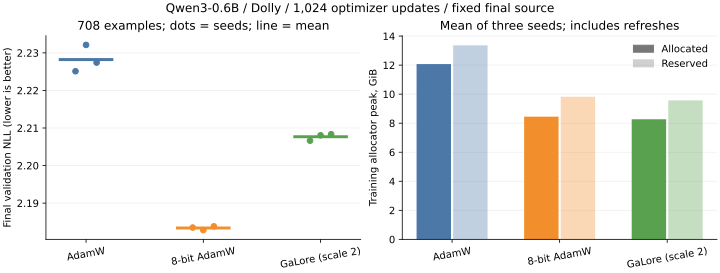
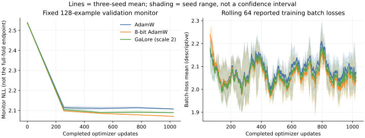

Qwen3-0.6B GaLore SFT evidence
=============================

.. note::

   Historical scale2 comparison. The current selected scale1 results and final
   acceptance checks are in :doc:`galore-sft-frontier`. Preserve the distinct
   source lineage, seeds and test results for each round.

This report describes one exploratory selected configuration on one fixed Dolly
split and budget. It does not establish a general algorithm advantage. Endpoint
quality is independently evaluated after 1,024 optimizer updates; test results
are secondary descriptive endpoints and were not used to choose the configuration.
All nine final runs use the same runtime source and frozen GPU harness, with seeds
0, 1 and 2 paired by every batch hash and response target count.

Configuration and provenance
----------------------------

Model: Qwen3-0.6B, ModelScope revision
09b42cad3d112e832108974449ccb5e8e0f5b5d1, tied 596,049,920 parameters,
BF16 with FP32 norms. Dataset:
ModelScope AI-ModelScope/databricks-dolly-15k, revision
40789acc12fc986e9145f87d159f19e2f1d75c6a, CC-BY-SA-3.0. Exact normalized
context/instruction-proxy groups are disjoint after exact deduplication;
this does not guarantee article, near-duplicate or pretraining-data separation.
Splits contain 13,544 training, 708 validation and 743 test examples.
Context512 uses response-preserving head/tail prompt truncation.
Final validation/test respectively score 52,181/55,562 response tokens.
Batch4, microbatch2; constant lr1e-5, betas(0.9,0.95), decay0.01, clip1.
GaLore: all eligible matrices, rank128, gap200, scale2, recycled projector with
oversampling16/one iteration/finalQR, exact compact masters, tiled fused
writeback, consumed-gradient release and experimental coordinate-moment transport.
Vocabulary exclusion is false for these final runs. All original weights train.
8-bit AdamW uses the existing repository implementation, not bitsandbytes.

Runtime SHA256: ``142c7be2c33f871badad4105bd682d4e34da3d3c32e17278dba67324e45c21e1``.
PyTorch ``2.6.0+cu124``, CUDA ``12.4``, device
``NVIDIA A100-SXM4-40GB``; source/extension/model/data/wrapper hashes and actual command
vectors with whitelisted launch settings are in the evidence archive. The model
weight hash is ``f47f71177f32bcd101b7573ec9171e6a57f4f4d31148d38e382306f42996874b``.
The raw frozen harness scripts retain original local default paths as evidence;
use ``../../scripts/galore_sft/README.md`` for the portable entry. The portable
entry has CPU mathematical AST and byte-for-byte data equivalence, but these
formal GPU runs used the external frozen scripts bundled here.

Final endpoint results
----------------------

.. csv-table::
   :header: "Method", "Seed", "Validation NLL", "Test NLL"

   "adamw", "0", "2.225108", "2.209756"
   "adamw", "1", "2.232122", "2.210387"
   "adamw", "2", "2.227420", "2.207771"
   "adam8", "0", "2.183493", "2.161001"
   "adam8", "1", "2.182816", "2.159504"
   "adam8", "2", "2.183816", "2.160611"
   "galore", "0", "2.206629", "2.187258"
   "galore", "1", "2.208054", "2.185289"
   "galore", "2", "2.208338", "2.188190"

.. csv-table::
   :header: "Method", "Validation mean", "Sample SD", "Relative mean vs AdamW (%)", "Test mean", "Quality gate <=2%"

   "adamw", "2.228217", "0.003574", "0.000000", "2.209304", "True"
   "adam8", "2.183375", "0.000510", "-2.012434", "2.160372", "True"
   "galore", "2.207674", "0.000916", "-0.921946", "2.186912", "True"

Relative mean is100*(method mean/AdamW mean-1), not a mean of seedwise ratios.
Three seeds are individual replicates; no ensemble or statistical significance
claim is made. Full-fold evaluation is token weighted, with the same counts for
all methods. The128-example inline monitor is descriptive and never an endpoint
selector; the final budget was fixed before the final group ran.

   Dots are individual seeds and horizontal lines are means. Memory bars use
   the full three-seed runs; the separate same-card probe is tabulated below.

   Shading is the seed range, not a confidence interval. Monitor and training
   batch-loss curves are descriptive and do not replace full-fold endpoints.

Training performance
--------------------

The primary comparison uses three fresh sequential processes on the same physical
GPU1, UUID ``GPU-d78c0eae-9ae7-3849-fa3d-f092f7502900``, with no foreign PID observed in the sampled
NVML audit. Each method runs402 updates, excluding2 warm-up updates;400 measured
batches, targets and the first forward loss are identical. GaLore includes the
two actual refreshes at steps200/400. No checkpoint, validation or test is read
or saved in this probe. This is a single-seed timing measurement, not an extra
quality replicate or a repeated-timing confidence interval.

.. csv-table::
   :header: "Method", "Category", "Updates", "Score+train ms/update", "Synchronized train ms/update", "Allocated peak GiB", "Reserved peak GiB", "Target tokens/s incl scoring"

   "adamw", "all", "400", "603.592430", "494.137026", "12.083508", "13.140625", "531.799248"
   "adamw", "normal", "400", "603.592430", "494.137026", "12.083508", "13.140625", "531.799248"
   "adam8", "all", "400", "575.669537", "466.542706", "8.453028", "9.667969", "557.594209"
   "adam8", "normal", "400", "575.669537", "466.542706", "8.453028", "9.667969", "557.594209"
   "galore", "all", "400", "623.697053", "520.285246", "8.271771", "9.367188", "514.656913"
   "galore", "normal", "398", "612.193396", "508.790378", "8.271771", "9.367188", "523.937792"
   "galore", "refresh", "2", "2912.924620", "2807.764094", "8.143436", "8.955078", "126.505162"

The timer is synchronized ``perf_counter`` around the training segment, using
``cuda.synchronize``; the legacy field name ``cuda_time_s`` does not mean CUDA
Events or kernel-only timing. Wall time also includes actor scoring and the
public training call, excluding batch preparation, logging and model init.
NVML one-second process-memory samples are lower bounds; allocator allocated
and reserved values above are distinct from those samples.

GaLore allocated-peak reduction is
31.545% vs AdamW and
2.144% vs8-bit. Scoring-plus-
training step time changes by
+3.331% and
+8.343%, respectively; corresponding
throughput changes are
-3.223% and
-7.700%. A step-time increase
is not the same percentage as a throughput decrease. The entire node was not
exclusive: other GPUs ran independent jobs.

The formal three-seed runs on their assigned GPUs are retained below as a
secondary timing/memory appendix; they remain the quality endpoints above.

.. csv-table::
   :header: "Method", "Seed", "Normal s/update", "Refresh s/update", "Normal allocated GiB", "Refresh allocated GiB", "Normal reserved GiB", "Refresh reserved GiB", "Target tokens/s incl scoring", "All training target tokens"

   "adamw", "0", "0.496616", "n/a", "12.079272", "n/a", "13.417969", "n/a", "510.848695", "315953"
   "adamw", "1", "0.480590", "n/a", "12.073505", "n/a", "13.365234", "n/a", "516.222900", "309318"
   "adamw", "2", "0.493379", "n/a", "12.069104", "n/a", "13.300781", "n/a", "496.919092", "306994"
   "adam8", "0", "0.469089", "n/a", "8.452389", "n/a", "9.843750", "n/a", "538.506052", "315953"
   "adam8", "1", "0.467240", "n/a", "8.447910", "n/a", "9.832031", "n/a", "523.375786", "309318"
   "adam8", "2", "0.465684", "n/a", "8.449708", "n/a", "9.791016", "n/a", "524.868735", "306994"
   "galore", "0", "0.503039", "2.873208", "8.275442", "8.173836", "9.589844", "9.107422", "496.797233", "315953"
   "galore", "1", "0.503113", "2.821274", "8.276593", "8.136583", "9.597656", "8.900391", "486.485565", "309318"
   "galore", "2", "0.514778", "2.836664", "8.261433", "8.085006", "9.525391", "8.833984", "476.163325", "306994"

The first two optimizer updates are excluded. Time sums all microbatch timings
per optimizer update; memory takes their maximum. Table times are arithmetic
means of normal/refresh update times; allocator columns are maxima within that
category. Throughput divides measured response targets by scoring-plus-training
wall time, including the native scorer, excluding monitor, checkpoint and final
evaluation I/O. Reserved memory is the allocator reservation, not live allocation.
Normal/refresh are distinguished using the actual per-update refresh flag.
Warm-up and contaminated steps are never silently added. Concurrent GPU jobs can
still affect shared CPU/host behavior; the clean same-card probe above is the
primary performance result, distinct from these full-budget quality runs.

Full gradients and decomposition footprint
------------------------------------------

A separate instrumented probe restores the actual selected seed0 checkpoint
at1,024 completed updates with the final runtime. Its tiny repository-text
probe uses context64/batch2, rather than the Dolly quality batch. It makes one
in-memory update, saves no checkpoint and performs no validation/test evaluation.
Its intentional peak resets invalidate ordinary timing; it is not another
quality replicate or the primary whole-model performance measurement.

Observed full FP32 gradients are2,384,199,680 bytes and remain live through
global clipping. They fall to zero after optimizer consumers finish. Unique
model storage is1,192,230,912 bytes; optimizer GPU buffers at entry are
1,922,482,176 bytes, with an additional4-byte writeback flag at exit. CPU
private-projector RNG is571,328 bytes, separately counted; no optimizer CPU
offload is used. These are actual storage inventories, not a replacement for
the allocated/reserved peak measurements above.

On the same real clipped151936-by-1024 FP32 vocabulary gradient
(622,329,856 bytes), the staged recycled sequence matches the unmodified helper
bit for bit. The allocator-visible decomposition measurements are:

.. csv-table::
   :header: "Operation", "Entry-to-peak bytes", "Entry-to-peak MiB", "Transient above entry/exit lower bound MiB"

   "Recycled, unmodified helper", "254840320", "243.035", "242.535"
   "Full reduced SVD, same gradient", "1877637632", "1790.655", "1192.651"

These include returned outputs and intermediate allocations; they are not
exclusive internal cuSolver workspace sizes. The large QR, final R-only QR
and small Ritz-SVD stage increases are158.472/84.862/0.692MiB. Sampled NVML
stage endpoints are lower bounds and cannot isolate external solver memory.
Raw stage records, original probe/helper code and the actual-import source
manifest are bundled. The old instrumentation's legacy metadata source digest
points to its historical tree; the independent launch manifest verifies the
actual imported final runtime and preserves this distinction explicitly.

For the required1024-by-1024 FP32/rank128 state check, the independent audit
measures1,572,864 bytes of moments plus basis and5,056 bytes of CPU private
RNG, totaling1,577,920 state bytes versus8,388,608 bytes for two FP32 AdamW
moments. Masters, full gradients, model storage and decomposition transients
are reported separately; compressed optimizer state is not total-memory saving.

Exploratory history and limits
------------------------------

The old all-matrix scale4 configuration failed the <=2% mean validation target:
+2.977129% at1,024 updates and +4.350% at4,096. Exact-vocabulary fallback at scale4
passed narrowly at +1.949812% at1,024, with a different memory tradeoff. Separate
seed0 development screens tested scale2, retained moments and rank256. Scale2
was selected after observing its training behavior and full validation
(2.206458 vs the old matched AdamW seed0's2.224296). This is exploratory validation
selection, not untouched-validation discovery. The final fixed scale2 group
reran all three seeds and all controls on the final source; seed0 is not an
additional independent development sample. Historical summaries/metadata and
the original audited reports are retained; they are not relabeled final passes.
No test endpoint was used to choose scale2. Native CUDA BF16 backward includes
existing nondeterministic operations: exact checkpoint restoration is not a
promise of bitwise identical full training trajectories. Strict small FP32
reference/resume tests use their original tolerances. Scope remains single-GPU
dense training; wider models, datasets, budgets and distributed execution have
not been established by this result.

Review and local checks
-----------------------

The post-oracle final-tree ordinary ``pytest tests/ -k cpu`` selection passed
1805 tests and12 subtests, with
28 skips and2222 deselected. This final-tree
result supersedes the earlier check snapshot, which remains bundled unchanged. Independent offline
reproduction passed18 overlapping tests with CUDA hidden, reproducing nine
files byte for byte. Whole-repo pinned Ruff0.15.17 lint/format and changed-file
whitespace/security/size hooks passed. This is local Python3.12 Linux/CUDA-host
evidence, not the full published GitHub CI matrix or every GPU test. Numerical
and public-Trainer resume artifacts are included as actually recorded; a partial
or failed probe is not converted to a pass by this report. The independent final
acceptance covers six CPU and six CUDA numerical cases and actual four-update
prefix/two-update public-Trainer continuation with immediate full-state equality.
The old auxiliary assertion equating a direct-B-SVD basis with the registered
QR(R.T)-SVD coordinates failed at6.616e-6 and is retained with its raw log. The
reviewed tests-only correction removes that different-factorization assumption;
production-versus-same-rule parameter, basis and moment comparisons retain all
original tolerances. The post-oracle whole-suite result is bundled separately.

The adjacent ``galore-sft-evidence/manifest.json`` lists every original raw file's
SHA256, byte length and archived path. The nine per-run ``*.tar.xz`` archives
and ``supporting.tar.xz`` contain complete
final-run attempts, including steps, curves, summaries, metadata, train/eval and
launcher logs, and event files; no training trajectory was truncated. It also
contains exact registered configuration, captured commands, audit implementation,
frozen wrappers, local checks and available independent acceptance artifacts.
Historical runs retain summary/metadata and audit snapshots, not their complete
old trajectories. Weights, checkpoints and the full Dolly corpus are excluded.
The archives total 6,379,756 bytes. Each is below the repository's 1,000 KiB
per-file limit; no original file or trajectory was removed or truncated.
The 5 MB total-size target is exceeded to retain complete evidence.

Extract each with ``tar -xJf "$archive"``. Verify each raw file against the
manifest, or use the bundled verifier. Paths in original configs are provenance,
not the sole means of accessing the bundled evidence. No full process environment
was captured. The manifest records snapshot hashes, complete pairing audits and
all numerical table values; local source paths need not exist to read the evidence.
